# Flet showcase

Small, complete apps that each show one thing [Flet](https://flet.dev) can do, from notification buttons to
on-device AI. Flet lets you build web, desktop and mobile apps in Python, with no frontend experience needed.

Every folder is one app you can read in a few minutes and run with a single command. Its README shows the app
running and links to the docs for everything it uses.

|                                                                      | App                                                 | What it shows                                                           |
|----------------------------------------------------------------------|-----------------------------------------------------|-------------------------------------------------------------------------|
| 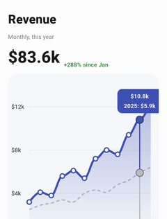  | [Animated line chart](animated-line-chart)          | A line chart that grows month by month, with a dashed comparison line   |
| 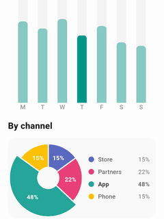   | [Bar and pie charts](bar-and-pie-charts)            | Bar and pie charts that glide to new data; tap a bar or a slice         |
| 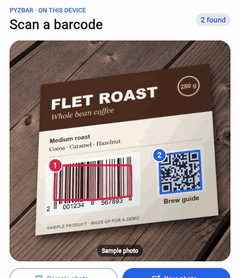      | [Barcode scanner](barcode-scanner)                  | pyzbar reads barcodes and QR codes in a photo; copy or open each one    |
| 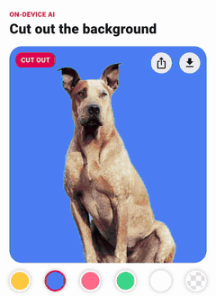   | [Cut out the background](cut-out-background)        | On-device AI cuts the subject out of a photo onto a new color           |
| 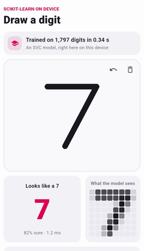     | [Digit recognizer](digit-recognizer)                | Draw a digit; scikit-learn trains on the device and guesses it          |
| 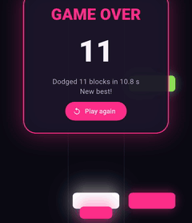           | [Dodge game](dodge-game)                            | An arcade game: drag to dodge falling blocks, with a 30 fps game loop   |
| 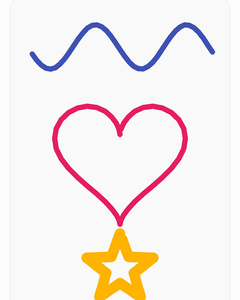       | [Drawing canvas](drawing-canvas)                    | Draw with a finger or mouse: colors, brush sizes, undo and recolor      |
| 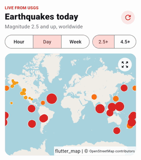    | [Earthquakes today](earthquakes-today)              | The USGS live quake feed on a map: filter, tap a quake for details      |
| 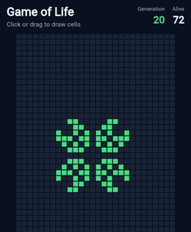         | [Game of Life](game-of-life)                        | Conway's Game of Life in NumPy, drawn with Canvas Points; tap and Play  |
| 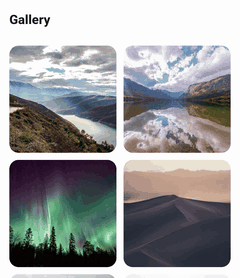       | [Hero animation](hero-animation)                    | A photo flies from a grid into its own page and back                    |
| 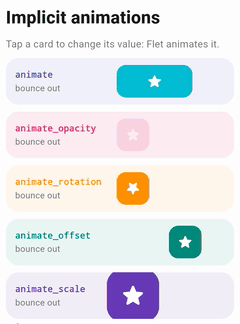  | [Implicit animations](implicit-animations)          | Size, color, fade, spin, slide and zoom that animate with your curve    |
| 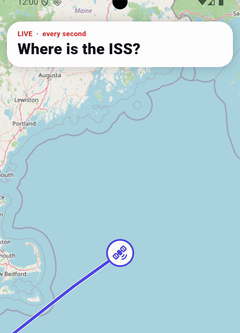          | [ISS tracker](iss-tracker)                          | The space station live on a map, every second, with its trail           |
| 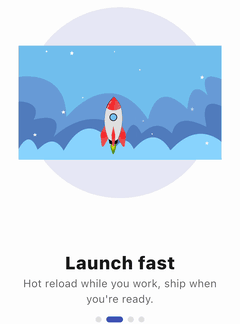    | [Lottie onboarding](lottie-onboarding)              | Onboarding with four Lottie animations from URLs, swipes and page dots  |
| 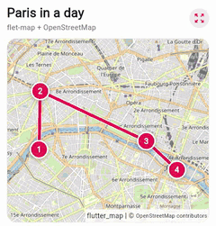             | [Map tour](map-tour)                                | Pins, a growing route and flights between stops on an OpenStreetMap     |
| 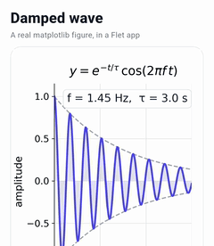    | [Matplotlib charts](matplotlib-charts)              | A live matplotlib figure that redraws as you drag sliders, with zoom    |
| 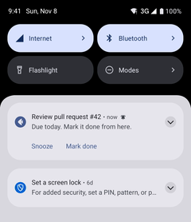 | [Notification action buttons](notification-actions) | Buttons in a notification that call your Python code                    |
| 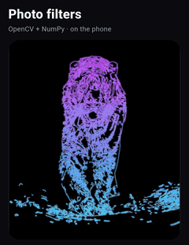        | [Photo filters](photo-filters)                      | Pencil, cartoon, neon and vintage filters with OpenCV, on the phone     |
| 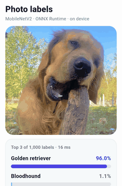         | [Photo labels](photo-labels)                        | MobileNetV2 names what's in a photo, on device, top 3 as growing bars   |
| 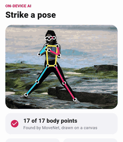      | [Pose estimation](pose-estimation)                  | An on-device AI model draws a skeleton on people in photos              |
| 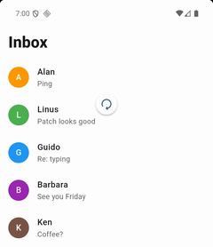      | [Pull to refresh](pull-to-refresh)                  | Pull a list down to load new items; a Refresh button on desktop and web |
| 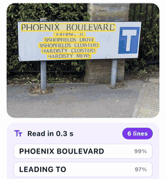 | [Read text from a photo](read-text-from-photo)      | Find and read every line of text in a photo with PP-OCR, on device      |
| 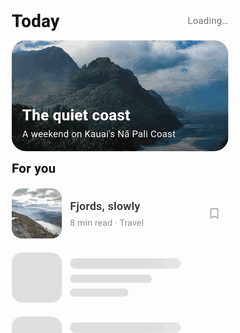      | [Shimmer loading](shimmer-loading)                  | Shimmering placeholders while a feed loads, then the real cards fade in |
| 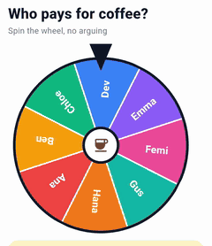       | [Spin the wheel](spin-the-wheel)                    | An animated wheel of names, with ticks made in Python with NumPy        |
| 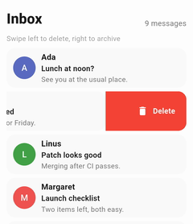     | [Swipe to dismiss](swipe-to-dismiss)                | Swipe emails away to archive or delete them, with undo                  |
| 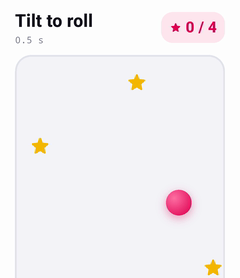            | [Tilt game](tilt-game)                              | Tilt the phone to roll a ball over the stars; arrow keys on desktop     |
| 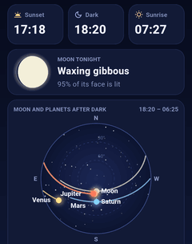         | [Tonight's sky](tonights-sky)                       | Tonight's sunset, Moon phase and planets where you are, with astropy    |
| 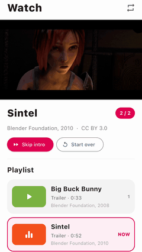       | [Video playlist](video-playlist)                    | A video player whose playlist follows what's playing; skip intros       |

## Run an app

Install [uv](https://docs.astral.sh/uv/), then:

```bash
git clone https://github.com/ndonkoHenri/flet-showcase
cd flet-showcase/pull-to-refresh   # choose and open an example
uv run flet run
```

Each folder's README says which platforms the app runs on and how to try it.

## New to Flet?

- [Get started](https://flet.dev/docs/getting-started/installation)
- [Try Flet Studio](https://studio.flet.dev), our web IDE, made with Flet itself
- [awesome-flet](https://github.com/flet-dev/awesome-flet), a community list of Flet apps, extensions, tutorials and more

## License

Everything is under the [MIT license](LICENSE), so... feel free!
