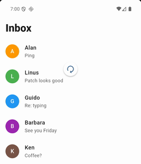
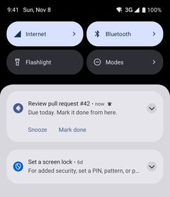

# Flet showcase

Small, complete apps that each show one thing [Flet](https://flet.dev) can do, from notification buttons to
on-device AI. Flet lets you build web, desktop and mobile apps in Python, with no frontend experience needed.

Every folder is one app you can read in a few minutes and run with a single command. Its README shows the app
running and links to the docs for everything it uses.

|                                                                      | App                                                 | What it shows                                                           |
|----------------------------------------------------------------------|-----------------------------------------------------|-------------------------------------------------------------------------|
|       | [Pull to refresh](pull-to-refresh)                  | Pull a list down to load new items; a Refresh button on desktop and web |
|  | [Notification action buttons](notification-actions) | Buttons in a notification that call your Python code                    |

## Run an app

Install [uv](https://docs.astral.sh/uv/), then:

```bash
git clone https://github.com/ndonkoHenri/flet-showcase
cd flet-showcase/pull-to-refresh   # choose and open an example
uv run flet run
```

Each folder's README says which platforms the app runs on and how to try it.

## New to Flet?

- [Get started](https://flet.dev/docs/getting-started/installation)
- [Try Flet Studio](https://studio.flet.dev), our web IDE, made with Flet itself
- [awesome-flet](https://github.com/flet-dev/awesome-flet), a community list of Flet apps, extensions, tutorials and more

## License

Everything is under the [MIT license](LICENSE), so... feel free!
