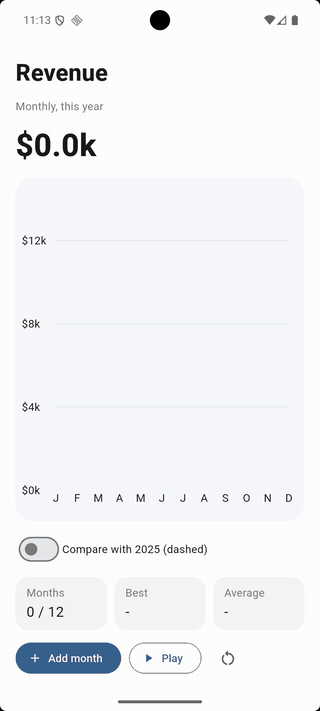
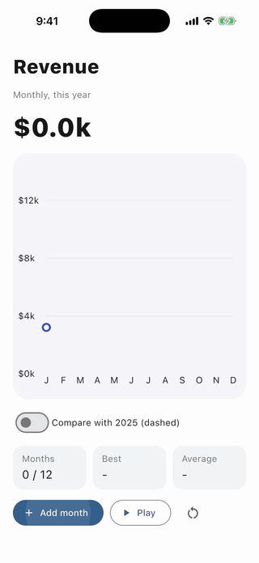
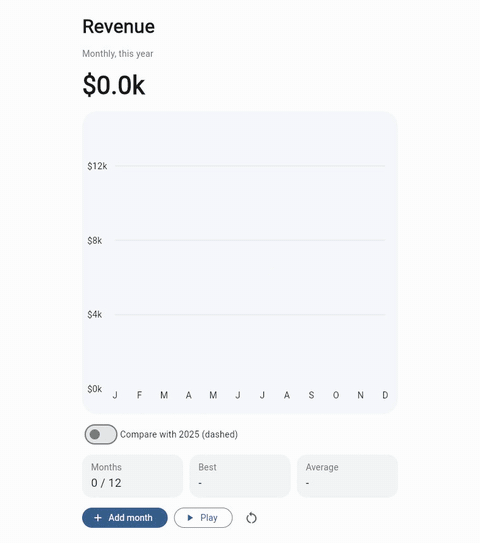

# Animated line chart

A small revenue dashboard built with [flet-charts](https://flet.dev/docs/controls/charts). Each month is a point in a
curved [`LineChart`](https://flet.dev/docs/controls/charts/linechart) series, with a gradient
([`below_line_gradient`](https://flet.dev/docs/controls/charts/types/linechartdata#flet_charts.line_chart_data.LineChartData.below_line_gradient))
filling the area under the line, and the totals update as the line grows:

- **Add month** appends a
  [`LineChartDataPoint`](https://flet.dev/docs/controls/charts/types/linechartdatapoint) to the series'
  [`points`](https://flet.dev/docs/controls/charts/types/linechartdata#flet_charts.line_chart_data.LineChartData.points)
  and updates the chart. The chart
  [animates](https://flet.dev/docs/controls/charts/linechart#flet_charts.line_chart.LineChart.animation) points that
  move, so the new point starts on the last one and then moves to its value: the line grows instead of jumping.
- **Play** adds the rest of the year, one month every half second.
- **Compare with 2025** adds a second, dashed series
  ([`dash_pattern`](https://flet.dev/docs/controls/charts/types/linechartdata#flet_charts.line_chart_data.LineChartData.dash_pattern))
  to the chart's
  [`data_series`](https://flet.dev/docs/controls/charts/linechart#flet_charts.line_chart.LineChart.data_series).
- **Hover a month** (desktop, web) **or press and hold it** (phone): the tooltip shows both years' values.
- The round arrow clears the chart.

|                                                       Android                                                        |                                                        iOS                                                         |
|:--------------------------------------------------------------------------------------------------------------------:|:------------------------------------------------------------------------------------------------------------------:|
|  |  |

|                                                                     Web                                                                      |
|:--------------------------------------------------------------------------------------------------------------------------------------------:|
|  |

The same code runs on macOS, Windows and Linux too.

## Run it

With [uv](https://docs.astral.sh/uv/):

```bash
uv run flet run           # desktop
uv run flet run --web     # browser
```

To try it on a phone, [debug](https://flet.dev/docs/cli/flet-debug) it on a connected device or emulator:

```bash
uv run flet debug android   # Android device or emulator
uv run flet debug ios       # iPhone or iOS simulator
```

To share it, [build](https://flet.dev/docs/publish) a package for any platform (desktop apps build on their own OS):

```bash
uv run flet build apk       # Android
uv run flet build ipa       # iOS
uv run flet build macos     # macOS app
uv run flet build windows   # Windows app
uv run flet build linux     # Linux app
uv run flet build web       # static website
```

## Learn more

- [LineChart docs](https://flet.dev/docs/controls/charts/linechart)
- [LineChartData](https://flet.dev/docs/controls/charts/types/linechartdata)
- [LineChartDataPoint](https://flet.dev/docs/controls/charts/types/linechartdatapoint)
- [LineChartDataPointTooltip](https://flet.dev/docs/controls/charts/types/linechartdatapointtooltip)
