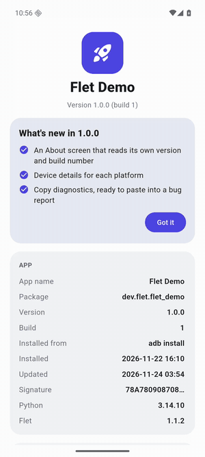
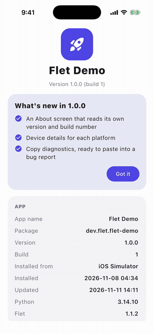
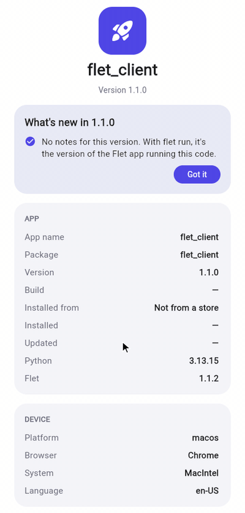

# App version

A classic About screen that never needs a hard-coded version string: the app asks for its own name, package id,
version and build number, shows what the device reports, and greets each new version with its release notes.

- [`page.get_package_info()`](https://flet.dev/docs/controls/page#flet.Page.get_package_info) returns a
  [`PackageInfo`](https://flet.dev/docs/types/packageinfo): the
  [`app_name`](https://flet.dev/docs/types/packageinfo#flet.PackageInfo.app_name),
  [`package_name`](https://flet.dev/docs/types/packageinfo#flet.PackageInfo.package_name),
  [`version`](https://flet.dev/docs/types/packageinfo#flet.PackageInfo.version) and
  [`build_number`](https://flet.dev/docs/types/packageinfo#flet.PackageInfo.build_number) the app was built with,
  plus where it was installed from
  ([`installer_store`](https://flet.dev/docs/types/packageinfo#flet.PackageInfo.installer_store)) and when
  ([`install_time`](https://flet.dev/docs/types/packageinfo#flet.PackageInfo.install_time),
  [`update_time`](https://flet.dev/docs/types/packageinfo#flet.PackageInfo.update_time)). `flet build`'s
  [`--build-version`](https://flet.dev/docs/cli/flet-build#--build-version) and
  [`--build-number`](https://flet.dev/docs/cli/flet-build#--build-number) flow straight into them (without them, the
  app's `pyproject.toml` gives `version` and `[tool.flet] build_number`).
- [`page.get_device_info()`](https://flet.dev/docs/controls/page#flet.Page.get_device_info) fills the **Device**
  card. It returns a different class on each platform
  ([`AndroidDeviceInfo`](https://flet.dev/docs/types/androiddeviceinfo),
  [`IosDeviceInfo`](https://flet.dev/docs/types/iosdeviceinfo), [`WebDeviceInfo`](https://flet.dev/docs/types/webdeviceinfo)...),
  so the app picks the model and system fields with a `match` on that class, and the language from
  [`locales`](https://flet.dev/docs/types/deviceinfo#flet.DeviceInfo.locales).
- **What's new in 1.0.0** shows the notes for the running version, once: **Got it** saves that version with
  [`SharedPreferences.set()`](https://flet.dev/docs/services/sharedpreferences#flet.SharedPreferences.set), and the
  card stays closed until the version changes. **What's new** opens it again.
- **Copy diagnostics** puts every line of both cards (the Python and Flet versions included) on the clipboard,
  ready to paste into a bug report. The button's [`action`](https://flet.dev/docs/controls/actioncontrol#flet.ActionControl.action)
  is a [`CopyToClipboard`](https://flet.dev/docs/types/copytoclipboard) set once the details are read, so the copy
  happens during the tap itself, which is when browsers allow it (Safari above all).

|                                                         Android                                                          |                                                          iOS                                                           |                                                         Web                                                          |
|:------------------------------------------------------------------------------------------------------------------------:|:----------------------------------------------------------------------------------------------------------------------:|:--------------------------------------------------------------------------------------------------------------------:|
|  |  |  |

The same code runs on macOS, Windows and Linux too. What each platform reports:

- **Android:** the app's label, `applicationId`, `versionName` and `versionCode`, the signing key's SHA-256, the
  installer (Google Play, `adb install`, or none when sideloaded) and the install and update times.
- **iOS:** the bundle's display name, identifier, short version and build, the installer (App Store, TestFlight or
  iOS Simulator) and the install and update times. No signature.
- **macOS, Windows and Linux:** name, id, version and build from the app bundle (macOS), the executable (Windows)
  or the build's `version.json` (Linux), and the app's file times. No store.
- **Web:** what the build's `version.json` says. No store and no install times.

The app recorded above is a `flet build` app, so it shows its own details. When you run the code with `flet run`,
the details are those of the Flet app that runs it: the Flet desktop app (`Flet`, `com.appveyor.flet`, the Flet
version), the Flet web client with `flet run --web` (`flet_client`, no build number), or the Flet app on the phone
with `flet debug`. Build it with `flet build` (any platform, `web` included) to see its own name and version.

## Run it

With [uv](https://docs.astral.sh/uv/):

```bash
uv run flet run           # desktop
uv run flet run --web     # browser
```

To try it on a phone, [debug](https://flet.dev/docs/cli/flet-debug) it on a connected device or emulator:

```bash
uv run flet debug android   # Android device or emulator
uv run flet debug ios       # iPhone or iOS simulator
```

To share it, [build](https://flet.dev/docs/publish) a package for any platform (desktop apps build on their own OS).
Add `--build-version 1.2.0 --build-number 7` to any of them and the About screen shows that version:

```bash
uv run flet build apk             # Android
uv run flet build ipa             # iOS
uv run flet build ios-simulator   # iOS simulator
uv run flet build macos           # macOS app
uv run flet build windows         # Windows app
uv run flet build linux           # Linux app
uv run flet build web             # static website
```

## Learn more

- [PackageInfo](https://flet.dev/docs/types/packageinfo)
- [Page](https://flet.dev/docs/controls/page)
- [DeviceInfo](https://flet.dev/docs/types/deviceinfo)
- [CopyToClipboard](https://flet.dev/docs/types/copytoclipboard)
- [SharedPreferences](https://flet.dev/docs/services/sharedpreferences)
- [flet build](https://flet.dev/docs/cli/flet-build)
