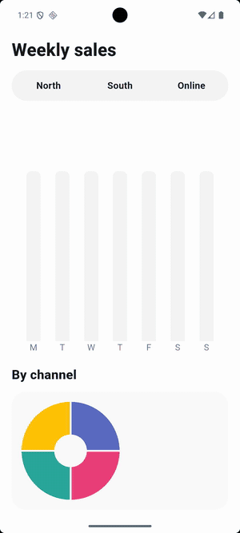
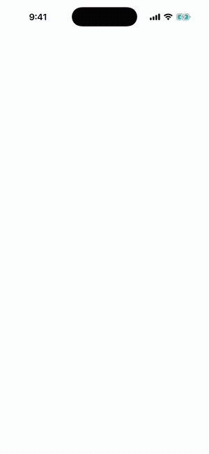

# Bar and pie charts

A small weekly sales dashboard built with [flet-charts](https://flet.dev/docs/controls/charts): a
[`BarChart`](https://flet.dev/docs/controls/charts/barchart) of the sales per day and a
[`PieChart`](https://flet.dev/docs/controls/charts/piechart) of the share per sales channel. Pick a region and both
charts glide to its numbers; tap a bar or a slice to read its value.

- **North, South, Online** switch the region. The app sets each bar's
  [`to_y`](https://flet.dev/docs/controls/charts/types/barchartrod#flet_charts.bar_chart_rod.BarChartRod.to_y) and each
  slice's [`value`](https://flet.dev/docs/controls/charts/types/piechartsection#flet_charts.pie_chart_section.PieChartSection.value),
  then updates the page once. Both charts'
  [`animation`](https://flet.dev/docs/controls/charts/barchart#flet_charts.bar_chart.BarChart.animation) is 600 ms, so
  every change moves instead of jumping. The bars start at zero and grow when the first numbers come in.
- **Tap a bar** (phone) **or hover it** (desktop, web): the chart's
  [`on_event`](https://flet.dev/docs/controls/charts/barchart#flet_charts.bar_chart.BarChart.on_event) gives its
  [`group_index`](https://flet.dev/docs/controls/charts/types/barchartevent#flet_charts.bar_chart.BarChartEvent.group_index),
  the bar turns solid and the line under the total shows that day's sales. A
  [tooltip](https://flet.dev/docs/controls/charts/types/barchartrod#flet_charts.bar_chart_rod.BarChartRod.tooltip)
  shows the value too, while the finger is down or the mouse is over the bar. With nothing picked, the best day of the
  week stands out.
- **Tap or hover a slice**: the pie's
  [`on_event`](https://flet.dev/docs/controls/charts/piechart#flet_charts.pie_chart.PieChart.on_event) gives its
  [`section_index`](https://flet.dev/docs/controls/charts/types/piechartevent#flet_charts.pie_chart.PieChartEvent.section_index),
  that slice gets a bigger
  [`radius`](https://flet.dev/docs/controls/charts/types/piechartsection#flet_charts.pie_chart_section.PieChartSection.radius)
  and pops out, and its legend line turns bold.
- On a phone, the picked day and channel stay picked when you switch regions, so you can compare them; tap beside the
  bars or the slices to clear them. With a mouse, the highlight follows the pointer and clears when it leaves the
  chart.
- On desktop and web, the **left and right arrow keys** switch regions too
  ([`on_keyboard_event`](https://flet.dev/docs/controls/page#flet.Page.on_keyboard_event)).

|                                                                Android                                                                |                                                                 iOS                                                                 |                                                                 Web                                                                  |
|:-------------------------------------------------------------------------------------------------------------------------------------:|:-----------------------------------------------------------------------------------------------------------------------------------:|:------------------------------------------------------------------------------------------------------------------------------------:|
|  |  |  |

The same code runs on macOS, Windows and Linux too.

## Run it

With [uv](https://docs.astral.sh/uv/):

```bash
uv run flet run           # desktop
uv run flet run --web     # browser
```

To try it on a phone, [debug](https://flet.dev/docs/cli/flet-debug) it on a connected device or emulator:

```bash
uv run flet debug android   # Android device or emulator
uv run flet debug ios       # iPhone or iOS simulator
```

To share it, [build](https://flet.dev/docs/publish) a package for any platform (desktop apps build on their own OS):

```bash
uv run flet build apk             # Android
uv run flet build ipa             # iOS
uv run flet build ios-simulator   # iOS simulator
uv run flet build macos           # macOS app
uv run flet build windows         # Windows app
uv run flet build linux           # Linux app
uv run flet build web             # static website
```

## Learn more

- [BarChart docs](https://flet.dev/docs/controls/charts/barchart)
- [PieChart docs](https://flet.dev/docs/controls/charts/piechart)
- [BarChartRod](https://flet.dev/docs/controls/charts/types/barchartrod)
- [PieChartSection](https://flet.dev/docs/controls/charts/types/piechartsection)
- [BarChartEvent](https://flet.dev/docs/controls/charts/types/barchartevent)
- [PieChartEvent](https://flet.dev/docs/controls/charts/types/piechartevent)
- [ChartEventType](https://flet.dev/docs/controls/charts/types/charteventtype)
