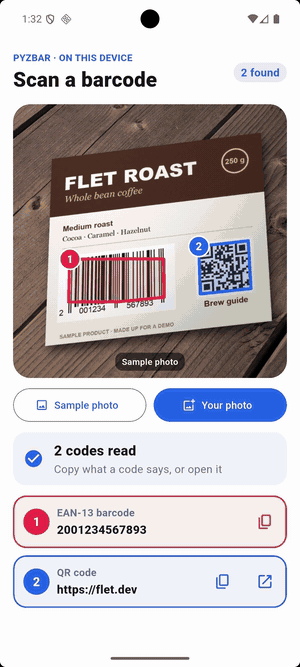
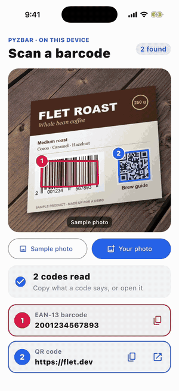
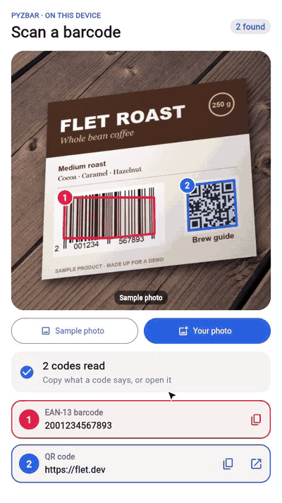

# Scan a barcode

Read the barcodes and QR codes in a photo, right on the device. [pyzbar](https://github.com/NaturalHistoryMuseum/pyzbar)
finds every code, and the app outlines each one on the photo and lists what it says, with buttons to copy it or open
the link. No server, no upload.

- `pyzbar.decode()` takes a [Pillow](https://python-pillow.org) image and returns every code it finds: its `type`
  (`EAN13`, `QRCODE`, `CODE128`...), its `data` as bytes, and its `polygon`, the code's corners in the photo. It runs
  in a thread (`asyncio.to_thread`), so the app stays responsive while a line sweeps over the photo
  ([`animate_position`](https://flet.dev/docs/controls/layoutcontrol#flet.LayoutControl.animate_position)).
- The outlines are drawn on a [`Canvas`](https://flet.dev/docs/controls/canvas): a
  [`Path`](https://flet.dev/docs/controls/canvas/path) through each code's corners, and a
  [`Circle`](https://flet.dev/docs/controls/canvas/circle) with a [`Text`](https://flet.dev/docs/controls/canvas/text)
  for its number. The canvas covers an [`Image`](https://flet.dev/docs/controls/image) of the photo in a
  [`Stack`](https://flet.dev/docs/controls/stack), and redraws when its size changes
  ([`on_resize`](https://flet.dev/docs/controls/canvas#flet.canvas.Canvas.on_resize)), so the outlines stay on the
  codes in any window.
- Each code gets a card with what it says. **Copy** puts it on the clipboard with a
  [`CopyToClipboard`](https://flet.dev/docs/types/copytoclipboard) action, and **Open** (for links) opens it with an
  [`OpenUrl`](https://flet.dev/docs/types/openurl) action. Both are the buttons'
  [`action`](https://flet.dev/docs/controls/actioncontrol#flet.ActionControl.action), which the app performs right
  inside the tap, the only time a browser allows them.
- **Sample photo** scans the photo that comes with the app. **Your photo** picks one of your own with
  [`FilePicker`](https://flet.dev/docs/services/filepicker)'s
  [`pick_files()`](https://flet.dev/docs/services/filepicker#flet.FilePicker.pick_files), which hands the app the
  file's [`bytes`](https://flet.dev/docs/types/filepickerfile#flet.FilePickerFile.bytes) on every platform. Big photos
  are scaled down to 1600 px first, and turned upright from their EXIF data.

|                                                         Android                                                          |                                                         iOS                                                         |
|:------------------------------------------------------------------------------------------------------------------------:|:-------------------------------------------------------------------------------------------------------------------:|
|  |  |

|                                                       Web                                                        |
|:----------------------------------------------------------------------------------------------------------------:|
|  |

The same code runs on macOS, Windows and Linux too. The sample photo was made for this app: a made-up coffee box on
*Weatherworn top of wooden table* by W.carter (Wikimedia Commons, CC0). Its barcode is an in-store-only number
(prefix 200, not a real product), and its QR code holds `https://flet.dev`.

## Run it

pyzbar needs the zbar library. On Windows, pyzbar's wheel brings it along; on macOS and Linux, install it first:

```bash
brew install zbar           # macOS
sudo apt install libzbar0   # Debian, Ubuntu
```

Homebrew puts zbar in `/opt/homebrew/lib` on Apple silicon Macs, where Python doesn't look by default, so the app
adds that folder to the search path before it imports pyzbar.

With [uv](https://docs.astral.sh/uv/):

```bash
uv run flet run           # desktop
uv run flet run --web     # browser
```

To try it on a phone, [debug](https://flet.dev/docs/cli/flet-debug) it on a connected device or emulator:

```bash
uv run flet debug android   # Android device or emulator
uv run flet debug ios       # iPhone or iOS simulator
```

To share it, [build](https://flet.dev/docs/publish) a package for any platform (desktop apps build on their own OS):

```bash
uv run flet build apk             # Android
uv run flet build ipa             # iOS
uv run flet build ios-simulator   # iOS simulator
uv run flet build macos           # macOS app
uv run flet build windows         # Windows app
uv run flet build linux           # Linux app
```

On Android and iOS, `flet build` takes pyzbar, the zbar library and Pillow from [pypi.flet.dev](https://pypi.flet.dev),
which has them built for phones (see
[binary packages](https://flet.dev/docs/reference/binary-packages-android-ios)). A macOS or Linux build looks for
zbar the same way `flet run` does, so the computer running it needs zbar installed too. There's no static web build
(`flet build web`): it runs Python inside the browser, where pyzbar and its zbar library aren't available. In a
browser, serve it with `uv run flet run --web` (or deploy it as a server app).

## Learn more

- [Canvas docs](https://flet.dev/docs/controls/canvas)
- [Path](https://flet.dev/docs/controls/canvas/path)
- [Circle](https://flet.dev/docs/controls/canvas/circle)
- [FilePicker](https://flet.dev/docs/services/filepicker)
- [FilePickerFile](https://flet.dev/docs/types/filepickerfile)
- [CopyToClipboard](https://flet.dev/docs/types/copytoclipboard)
- [OpenUrl](https://flet.dev/docs/types/openurl)
- [Binary packages for Android and iOS](https://flet.dev/docs/reference/binary-packages-android-ios)
- [pyzbar](https://github.com/NaturalHistoryMuseum/pyzbar)
