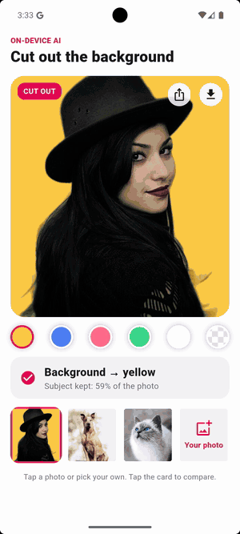
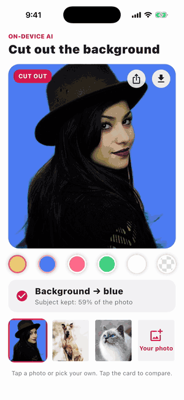
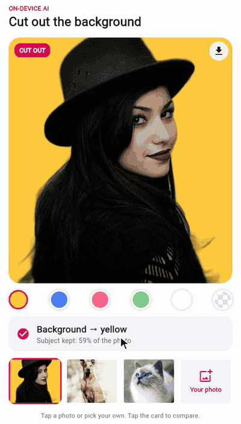

# Cut out the background

A small AI model finds the person or animal in a photo, keeps them and makes everything else see-through, so you can
put them on any color you like. It all runs on the device, with no server and no download, so it works offline from
the first launch.

- The model is [U²-Net](https://github.com/xuebinqin/U-2-Net) small ("u2netp"), a 4.6 MB ONNX file that ships with
  the app in `assets/`, next to the three sample photos. The app loads it once when it starts. One `model.run()` in
  [onnxruntime](https://onnxruntime.ai) gives a 320×320 mask of the subject;
  [OpenCV](https://opencv.org) stretches it to the photo's size and adds it as a see-through (alpha) channel, and
  `cv2.imencode(".png", ...)` turns the result into PNG bytes for an [`Image`](https://flet.dev/docs/controls/image)'s
  [`src`](https://flet.dev/docs/controls/image#flet.Image.src).
- The card is a [`Stack`](https://flet.dev/docs/controls/stack): the cut-out on the new background, and the original
  photo on top. Once the subject is found, the photo fades away
  ([`animate_opacity`](https://flet.dev/docs/controls/layoutcontrol#flet.LayoutControl.animate_opacity)) and the
  cut-out stays. **Tap the card** to bring the original back and compare.
- **Tap a color** to change the background: it's the
  [`bgcolor`](https://flet.dev/docs/controls/container#flet.Container.bgcolor) of the
  [`Container`](https://flet.dev/docs/controls/container) behind the cut-out. The last one keeps it see-through and
  shows a checkerboard: a tiny PNG made with NumPy, set as the container's
  [`image`](https://flet.dev/docs/controls/container#flet.Container.image), a
  [`DecorationImage`](https://flet.dev/docs/types/decorationimage) with
  [`repeat`](https://flet.dev/docs/types/decorationimage#flet.DecorationImage.repeat).
- **Tap a photo** to cut it out, or **Your photo** to pick one of your own with
  [`FilePicker`](https://flet.dev/docs/services/filepicker)'s
  [`pick_files()`](https://flet.dev/docs/services/filepicker#flet.FilePicker.pick_files), which hands the app the
  file's [`bytes`](https://flet.dev/docs/types/filepickerfile#flet.FilePickerFile.bytes) on every platform.
- **Save** (the download icon) writes the cut-out as a PNG, on the chosen color or see-through, with
  [`save_file()`](https://flet.dev/docs/services/filepicker#flet.FilePicker.save_file): a save dialog on desktop,
  Android and iOS, a download in a browser. On Android and iOS, **Share** opens the share sheet with
  [`Share`](https://flet.dev/docs/services/share)'s
  [`share_files()`](https://flet.dev/docs/services/share#flet.Share.share_files), to send the PNG to another app or
  save it to the photos.
- The model runs in a thread (`asyncio.to_thread`), so the app stays responsive while it works.

|                                                                            Android                                                                            |                                                                             iOS                                                                             |                                                                            Web                                                                             |
|:-------------------------------------------------------------------------------------------------------------------------------------------------------------:|:-----------------------------------------------------------------------------------------------------------------------------------------------------------:|:----------------------------------------------------------------------------------------------------------------------------------------------------------:|
|  |  |  |

The same code runs on macOS, Windows and Linux too. Photos from Wikimedia Commons (CC0, from Unsplash):
*Dark-haired woman by a tree* by Allef Vinicius, *Top Dog* by Gabriel Jimenez, *Startled blue-eyed cat* by Mikhail
Vasilyev, and, picked in the recordings, *Macaw parrot* by Andrew Pons. U²-Net is by Xuebin Qin et al. (Apache-2.0);
the ONNX file comes from [rembg](https://github.com/danielgatis/rembg) (MIT). Both licenses are in
`assets/u2netp_LICENSE.txt`, which travels with the model.

## Run it

With [uv](https://docs.astral.sh/uv/):

```bash
uv run flet run           # desktop
uv run flet run --web     # browser
```

To try it on a phone, [debug](https://flet.dev/docs/cli/flet-debug) it on a connected device or emulator:

```bash
uv run flet debug android   # Android device or emulator
uv run flet debug ios       # iPhone or iOS simulator
```

To share it, [build](https://flet.dev/docs/publish) a package for any platform (desktop apps build on their own OS):

```bash
uv run flet build apk             # Android
uv run flet build ipa             # iOS
uv run flet build ios-simulator   # iOS simulator
uv run flet build macos           # macOS app
uv run flet build windows         # Windows app
uv run flet build linux           # Linux app
```

On Android and iOS, `flet build` takes onnxruntime, opencv-python and numpy from
[pypi.flet.dev](https://pypi.flet.dev), which has them built for phones (see
[binary packages](https://flet.dev/docs/reference/binary-packages-android-ios)). There's no static web build
(`flet build web`): it runs Python inside the browser, where onnxruntime and OpenCV aren't available. In a browser,
serve it with `uv run flet run --web` (or deploy it as a server app).

## Learn more

- [Image docs](https://flet.dev/docs/controls/image)
- [Stack](https://flet.dev/docs/controls/stack)
- [Container](https://flet.dev/docs/controls/container)
- [DecorationImage](https://flet.dev/docs/types/decorationimage)
- [FilePicker](https://flet.dev/docs/services/filepicker)
- [FilePickerFile](https://flet.dev/docs/types/filepickerfile)
- [Share](https://flet.dev/docs/services/share)
- [ShareFile](https://flet.dev/docs/types/sharefile)
- [Binary packages for Android and iOS](https://flet.dev/docs/reference/binary-packages-android-ios)
- [U²-Net](https://github.com/xuebinqin/U-2-Net)
