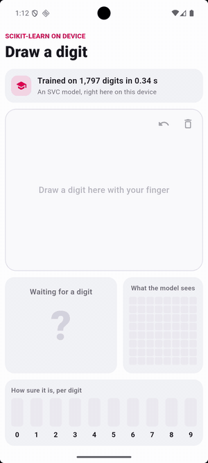
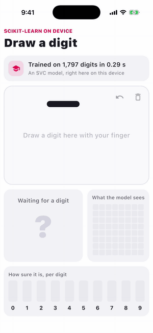
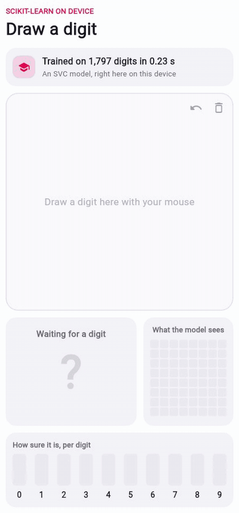

# Draw a digit

Draw a digit with your finger (or the mouse), and a small machine-learning model guesses which one it is, with how
sure it is of each digit from 0 to 9. The model learns what handwritten digits look like right on the device, when
the app starts, with [scikit-learn](https://scikit-learn.org). Nothing is downloaded and there's no server.

- The training data is scikit-learn's built-in `load_digits()`: 1,797 handwritten digits, 8×8 pixels each, that ship
  inside the package. An `SVC(gamma=0.001, C=10)` learns them in a fraction of a second, in a thread
  (`asyncio.to_thread`), while the app shows a spinner. A `CalibratedClassifierCV` around it turns its scores into a
  confidence per digit.
- Your strokes come from a [`GestureDetector`](https://flet.dev/docs/controls/gesturedetector) set as the
  [`content`](https://flet.dev/docs/controls/canvas#flet.canvas.Canvas.content) of a
  [`Canvas`](https://flet.dev/docs/controls/canvas):
  [`on_pan_update`](https://flet.dev/docs/controls/gesturedetector#flet.GestureDetector.on_pan_update) gets each new
  [`local_position`](https://flet.dev/docs/types/dragupdateevent#flet.DragUpdateEvent.local_position), and the app adds
  a [`Line`](https://flet.dev/docs/controls/canvas/line) to the canvas
  [`shapes`](https://flet.dev/docs/controls/canvas#flet.canvas.Canvas.shapes).
  [`drag_interval`](https://flet.dev/docs/controls/gesturedetector#flet.GestureDetector.drag_interval) keeps the
  updates to about 60 a second.
- **Lift your finger** and [`on_pan_end`](https://flet.dev/docs/controls/gesturedetector#flet.GestureDetector.on_pan_end)
  shrinks the drawing to the same 8×8 grid of 0–16 the model learned from, and the model guesses again. The guess
  updates after every stroke, so you can watch a 4 go from "7" to "4" as you draw it.
- Next to the guess, **What the model sees** shows that 8×8 grid, and the bars show the confidence per digit. They
  grow with [`Container`](https://flet.dev/docs/controls/container)'s implicit
  [`animate`](https://flet.dev/docs/controls/container#flet.Container.animate). Below 50%, the app says "Maybe a …?".
- **Undo** removes the last stroke and **Clear** starts over. With a keyboard, Backspace and Esc do the same
  ([`on_keyboard_event`](https://flet.dev/docs/controls/page#flet.Page.on_keyboard_event)).

|                                                         Android                                                         |                                                          iOS                                                          |                                                                     Web                                                                      |
|:-----------------------------------------------------------------------------------------------------------------------:|:---------------------------------------------------------------------------------------------------------------------:|:--------------------------------------------------------------------------------------------------------------------------------------------:|
|  |  |  |

The same code runs on macOS, Windows and Linux too, drawn with the mouse, in a phone-shaped window. The training
digits are the UCI "Optical Recognition of Handwritten Digits" set (CC BY 4.0), bundled with scikit-learn
(BSD-3-Clause).

## Run it

With [uv](https://docs.astral.sh/uv/):

```bash
uv run flet run           # desktop
uv run flet run --web     # browser
```

To try it on a phone, [debug](https://flet.dev/docs/cli/flet-debug) it on a connected device or emulator:

```bash
uv run flet debug android   # Android device or emulator
uv run flet debug ios       # iPhone or iOS simulator
```

To share it, [build](https://flet.dev/docs/publish) a package for any platform (desktop apps build on their own OS):

```bash
uv run flet build apk             # Android
uv run flet build ipa             # iOS
uv run flet build ios-simulator   # iOS simulator
uv run flet build macos           # macOS app
uv run flet build windows         # Windows app
uv run flet build linux           # Linux app
```

On Android and iOS, `flet build` takes scikit-learn, SciPy and NumPy from [pypi.flet.dev](https://pypi.flet.dev),
which has them built for phones (see
[binary packages](https://flet.dev/docs/reference/binary-packages-android-ios)). On Android, scikit-learn reads files
next to its modules, so `pyproject.toml` ships it unzipped with
[`extract_packages`](https://flet.dev/docs/updates/breaking-changes/v0-86-0/android-extract-packages). There's no
static web build (`flet build web`): it runs Python inside the browser, where the app can't start the training
thread, and where scikit-learn 1.9 isn't available yet. In a browser, serve it with `uv run flet run --web` (or deploy
it as a server app).

## Learn more

- [Canvas docs](https://flet.dev/docs/controls/canvas)
- [GestureDetector](https://flet.dev/docs/controls/gesturedetector)
- [Line](https://flet.dev/docs/controls/canvas/line)
- [DragUpdateEvent](https://flet.dev/docs/types/dragupdateevent)
- [Binary packages for Android and iOS](https://flet.dev/docs/reference/binary-packages-android-ios)
- [scikit-learn's digits dataset](https://scikit-learn.org/stable/modules/generated/sklearn.datasets.load_digits.html)
