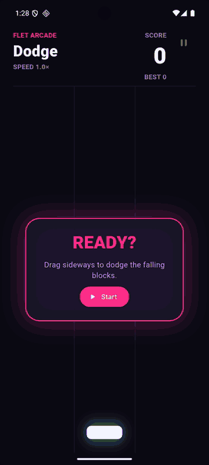
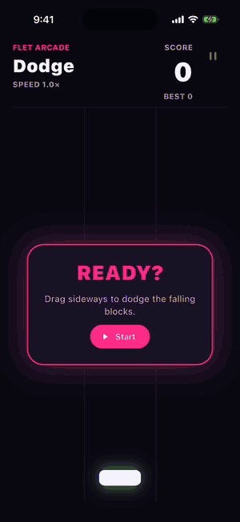
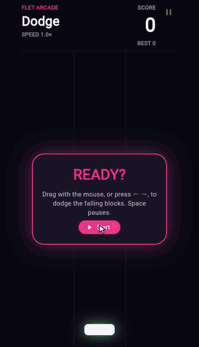

# Dodge game

A tiny arcade game with no game engine: neon blocks fall down three lanes, and you slide the bar at the bottom to
dodge them. They fall faster and faster until one hits you.

- The board is a [`Stack`](https://flet.dev/docs/controls/stack): the blocks and the player are plain
  [`Container`](https://flet.dev/docs/controls/container)s, moved by changing their
  [`left`](https://flet.dev/docs/controls/layoutcontrol#flet.LayoutControl.left) and
  [`top`](https://flet.dev/docs/controls/layoutcontrol#flet.LayoutControl.top).
- **Drag sideways** and the player follows your finger (or the mouse): a
  [`GestureDetector`](https://flet.dev/docs/controls/gesturedetector)'s
  [`on_horizontal_drag_update`](https://flet.dev/docs/controls/gesturedetector#flet.GestureDetector.on_horizontal_drag_update)
  gives the pointer's
  [`local_position`](https://flet.dev/docs/types/dragupdateevent#flet.DragUpdateEvent.local_position) on the board.
- **On a keyboard,** the left and right arrows hop one lane, and Space pauses or resumes: a
  [`KeyboardListener`](https://flet.dev/docs/controls/keyboardlistener) gets the keys in
  [`on_key_down`](https://flet.dev/docs/controls/keyboardlistener#flet.KeyboardListener.on_key_down).
- A game loop, started with [`page.run_task`](https://flet.dev/docs/controls/page#flet.Page.run_task), runs about 30
  times a second: the blocks fall by speed × time since the last frame, the ones that pass you add to the score,
  a new row comes in every 250 px, and the app checks for a hit before it redraws.
- **The game ramps up:** the fall speed grows every second (shown as `SPEED 1.4×`), and rows of two blocks get more
  common than single ones. There is always a gap.
- **Start, pause, play again:** the card over the board fades and pops in with
  [`animate_opacity`](https://flet.dev/docs/controls/layoutcontrol#flet.LayoutControl.animate_opacity) and
  [`animate_scale`](https://flet.dev/docs/controls/layoutcontrol#flet.LayoutControl.animate_scale). The game also
  pauses by itself when you leave the app or the window
  ([`on_app_lifecycle_state_change`](https://flet.dev/docs/controls/page#flet.Page.on_app_lifecycle_state_change))
  or close the browser tab ([`on_disconnect`](https://flet.dev/docs/controls/page#flet.Page.on_disconnect)).
- **Game over:** the block that hit you flashes, the phone buzzes
  ([`HapticFeedback.heavy_impact`](https://flet.dev/docs/services/hapticfeedback#flet.HapticFeedback.heavy_impact)),
  and a new best score is saved with [`SharedPreferences`](https://flet.dev/docs/services/sharedpreferences), so it's
  still there next time.

|                                                       Android                                                       |                                                   iOS                                                   |
|:-------------------------------------------------------------------------------------------------------------------:|:-------------------------------------------------------------------------------------------------------:|
|  |  |

|                                                    Web                                                    |
|:---------------------------------------------------------------------------------------------------------:|
|  |

The same code runs on macOS, Windows and Linux too, played with the mouse or the arrow keys.

## Run it

With [uv](https://docs.astral.sh/uv/):

```bash
uv run flet run           # desktop
uv run flet run --web     # browser
```

To try it on a phone, [debug](https://flet.dev/docs/cli/flet-debug) it on a connected device or emulator:

```bash
uv run flet debug android   # Android device or emulator
uv run flet debug ios       # iPhone or iOS simulator
```

To share it, [build](https://flet.dev/docs/publish) a package for any platform (desktop apps build on their own OS):

```bash
uv run flet build apk             # Android
uv run flet build ipa             # iOS
uv run flet build ios-simulator   # iOS simulator
uv run flet build macos           # macOS app
uv run flet build windows         # Windows app
uv run flet build linux           # Linux app
uv run flet build web             # static website
```

## Learn more

- [GestureDetector docs](https://flet.dev/docs/controls/gesturedetector)
- [Stack](https://flet.dev/docs/controls/stack)
- [KeyboardListener](https://flet.dev/docs/controls/keyboardlistener)
- [DragUpdateEvent](https://flet.dev/docs/types/dragupdateevent)
- [SharedPreferences](https://flet.dev/docs/services/sharedpreferences)
- [HapticFeedback](https://flet.dev/docs/services/hapticfeedback)
