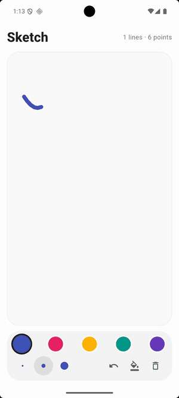
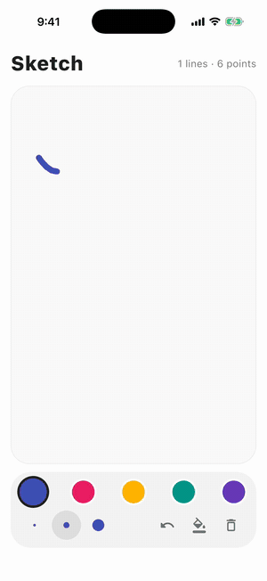
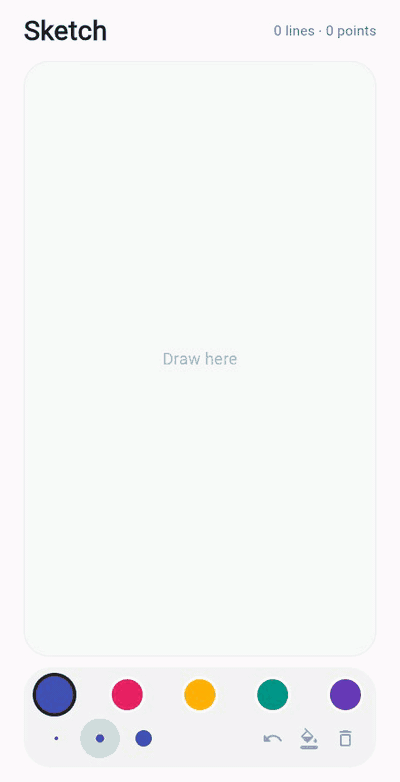

# Drawing canvas

A small sketch pad: draw with your finger or the mouse, pick a color and a brush size, undo the last line, recolor
every line at once, or start over.

- The drawing is a [`Canvas`](https://flet.dev/docs/controls/canvas). Each line you draw is one
  [`Points`](https://flet.dev/docs/controls/canvas/points) shape in
  [`POLYGON`](https://flet.dev/docs/types/pointmode#flet.canvas.PointMode.POLYGON) mode, which joins its
  [`points`](https://flet.dev/docs/controls/canvas/points#flet.canvas.Points.points) into one stroke.
- A [`GestureDetector`](https://flet.dev/docs/controls/gesturedetector) on top of the canvas follows your finger:
  [`on_pan_start`](https://flet.dev/docs/controls/gesturedetector#flet.GestureDetector.on_pan_start) starts a new
  line, and each [`on_pan_update`](https://flet.dev/docs/controls/gesturedetector#flet.GestureDetector.on_pan_update)
  appends its [`local_position`](https://flet.dev/docs/types/dragupdateevent#flet.DragUpdateEvent.local_position)
  to it, so the line grows as you move.
  [`drag_interval`](https://flet.dev/docs/controls/gesturedetector#flet.GestureDetector.drag_interval) sends a move
  every 10 ms at most, and [`on_pan_end`](https://flet.dev/docs/controls/gesturedetector#flet.GestureDetector.on_pan_end)
  adds the point where you lifted. A tap ([`on_tap_up`](https://flet.dev/docs/controls/gesturedetector#flet.GestureDetector.on_tap_up))
  draws a dot, with [`POINTS`](https://flet.dev/docs/types/pointmode#flet.canvas.PointMode.POINTS) mode.
- **Colors and brush sizes:** each line gets its own [`Paint`](https://flet.dev/docs/types/paint), with the
  [`color`](https://flet.dev/docs/types/paint#flet.Paint.color) and
  [`stroke_width`](https://flet.dev/docs/types/paint#flet.Paint.stroke_width) you picked and a round
  [`stroke_cap`](https://flet.dev/docs/types/paint#flet.Paint.stroke_cap), so lines have soft ends.
- **Recolor** gives every line a new paint in the current color, keeping its width.
- **Undo** removes the last line or dot from [`shapes`](https://flet.dev/docs/controls/canvas#flet.canvas.Canvas.shapes),
  and **Clear** removes them all. The header counts the lines and their points.

|                                                                Android                                                                 |                                                                 iOS                                                                  |                                                               Web                                                               |
|:--------------------------------------------------------------------------------------------------------------------------------------:|:------------------------------------------------------------------------------------------------------------------------------------:|:-------------------------------------------------------------------------------------------------------------------------------:|
|  |  |  |

The same code runs on macOS, Windows and Linux too. On phones you draw with your finger; with a mouse you drag
with the button down, the pointer turns into a crosshair over the canvas
([`mouse_cursor`](https://flet.dev/docs/controls/gesturedetector#flet.GestureDetector.mouse_cursor)), and
Ctrl+Z (Cmd+Z on a Mac) undoes the last line
([`on_keyboard_event`](https://flet.dev/docs/controls/page#flet.Page.on_keyboard_event)).

## Run it

With [uv](https://docs.astral.sh/uv/):

```bash
uv run flet run           # desktop
uv run flet run --web     # browser
```

To try it on a phone, [debug](https://flet.dev/docs/cli/flet-debug) it on a connected device or emulator:

```bash
uv run flet debug android   # Android device or emulator
uv run flet debug ios       # iPhone or iOS simulator
```

To share it, [build](https://flet.dev/docs/publish) a package for any platform (desktop apps build on their own OS):

```bash
uv run flet build apk             # Android
uv run flet build ipa             # iOS
uv run flet build ios-simulator   # iOS simulator
uv run flet build macos           # macOS app
uv run flet build windows         # Windows app
uv run flet build linux           # Linux app
uv run flet build web             # static website
```

## Learn more

- [Canvas docs](https://flet.dev/docs/controls/canvas)
- [Points](https://flet.dev/docs/controls/canvas/points)
- [PointMode](https://flet.dev/docs/types/pointmode)
- [Paint](https://flet.dev/docs/types/paint)
- [GestureDetector](https://flet.dev/docs/controls/gesturedetector)
- [DragStartEvent](https://flet.dev/docs/types/dragstartevent)
- [DragUpdateEvent](https://flet.dev/docs/types/dragupdateevent)
- [TapEvent](https://flet.dev/docs/types/tapevent)
