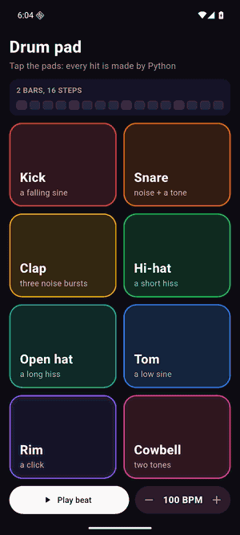
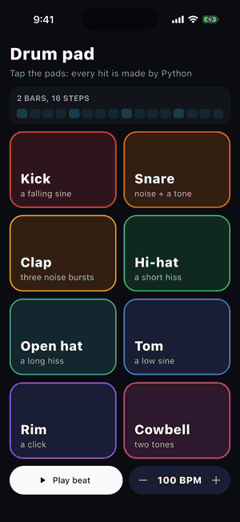
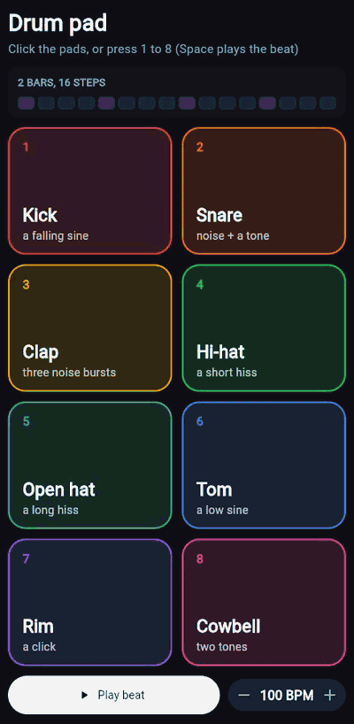

# Drum pad

A drum pad whose eight sounds are computed in Python. There are no sound files: NumPy makes each drum from sine
waves and random noise, and Python's `wave` module turns it into WAV bytes that flet-audio plays. Tap a pad and it
flashes, or press **Play beat** and a two-bar beat plays on a loop, the step row following along.

- **Kick**: a sine whose pitch falls from 155 Hz to 45 Hz (`np.cumsum` of the pitch keeps the wave smooth), dying
  away with `np.exp(-8 * t)`. **Snare**: `rng.uniform()` noise plus a 185 Hz tone, cut short. **Hi-hat** and
  **Open hat**: noise with the low end removed, short or long. **Clap**: three quick noise bursts. **Tom**, **Rim**
  and **Cowbell** are a low sine, a click and two clashing tones. All eight are made once, when the app starts.
- Each pad has its own [`flet_audio.Audio`](https://flet.dev/docs/services/audio), playing straight from the WAV
  bytes ([`src`](https://flet.dev/docs/services/audio#flet_audio.Audio.src)).
  [`release_mode=STOP`](https://flet.dev/docs/services/audio/types/releasemode#flet_audio.ReleaseMode.STOP) keeps
  each sound loaded, so [`play()`](https://flet.dev/docs/services/audio#flet_audio.Audio.play) starts it again at
  once, even while it still rings.
- **Tap a pad** (or click it): a [`Container`](https://flet.dev/docs/controls/container) plays on
  [`on_tap_down`](https://flet.dev/docs/controls/container#flet.Container.on_tap_down), when the finger lands, not
  when it lifts. Its [`animate`](https://flet.dev/docs/controls/container#flet.Container.animate) and
  [`animate_scale`](https://flet.dev/docs/controls/layoutcontrol#flet.LayoutControl.animate_scale) flash the pad in
  its color and press it in a little.
- **Play beat** loops a 16-step pattern (eighth notes, two bars) over all eight pads, and the row of steps lights
  the one playing. The loop keeps time on the event loop's clock: each step waits for its planned moment with
  `asyncio.sleep()`, and each hit's `play()` runs as its own task with
  [`page.run_task()`](https://flet.dev/docs/controls/page#flet.Page.run_task), so the beat doesn't drift.
  **Stop** ends it.
- **− / +** set the tempo from 60 to 180 BPM, in steps of 5, even while the beat plays. You can tap along on the
  pads too.
- **On a computer keyboard**, keys `1` to `8` play the pads, as the numbers on them show, and `Space` plays or
  stops the beat. [`page.on_keyboard_event`](https://flet.dev/docs/controls/page#flet.Page.on_keyboard_event) hears
  them wherever the focus is, and leaves shortcuts with Ctrl, Alt or Cmd alone.
- Closing the browser tab or the window stops the beat
  ([`on_disconnect`](https://flet.dev/docs/controls/page#flet.Page.on_disconnect),
  [`on_close`](https://flet.dev/docs/controls/page#flet.Page.on_close)), so it doesn't play on for no one.

|                                                               Android                                                               |                                                                iOS                                                                |                                                                Web                                                                 |
|:-----------------------------------------------------------------------------------------------------------------------------------:|:---------------------------------------------------------------------------------------------------------------------------------:|:----------------------------------------------------------------------------------------------------------------------------------:|
|  |  |  |

The recordings are silent (GIFs have no sound): run the app to hear it. The same code runs on macOS, Windows and
Linux too, where the number keys play the pads as in a browser. On iOS and macOS, flet-audio can't play bytes yet,
so the app writes each sound to a `.wav` file there first.

## Run it

With [uv](https://docs.astral.sh/uv/):

```bash
uv run flet run           # desktop
uv run flet run --web     # browser
```

To try it on a phone, [debug](https://flet.dev/docs/cli/flet-debug) it on a connected device or emulator:

```bash
uv run flet debug android   # Android device or emulator
uv run flet debug ios       # iPhone or iOS simulator
```

To share it, [build](https://flet.dev/docs/publish) a package for any platform (desktop apps build on their own OS):

```bash
uv run flet build apk             # Android
uv run flet build ipa             # iOS
uv run flet build ios-simulator   # iOS simulator
uv run flet build macos           # macOS app
uv run flet build windows         # Windows app
uv run flet build linux           # Linux app
uv run flet build web             # static website
```

## Learn more

- [Audio docs](https://flet.dev/docs/services/audio)
- [Animations cookbook](https://flet.dev/docs/cookbook/animations)
- [ReleaseMode](https://flet.dev/docs/services/audio/types/releasemode)
- [Container](https://flet.dev/docs/controls/container)
- [TapEvent](https://flet.dev/docs/types/tapevent)
- [KeyboardEvent](https://flet.dev/docs/types/keyboardevent)
- [Animation](https://flet.dev/docs/types/animation)
- [IconButton](https://flet.dev/docs/controls/iconbutton)
