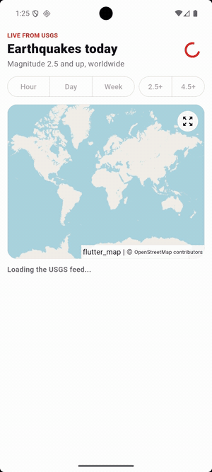
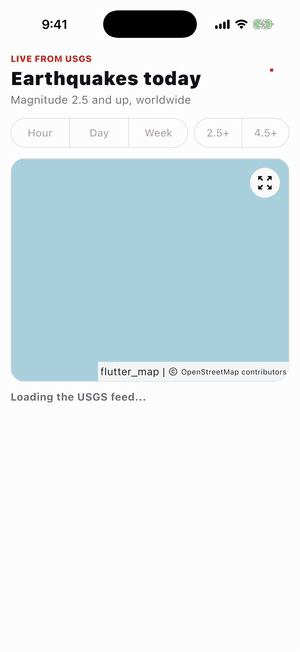
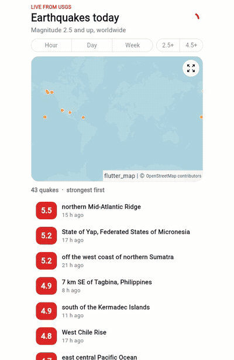

# Earthquakes today

Every earthquake of the last hour, day or week, live from the
[US Geological Survey (USGS)](https://earthquake.usgs.gov/earthquakes/feed/) feed, on a
[flet-map](https://flet.dev/docs/controls/map) world map, with a list below, strongest first:

- Each quake is a [`CircleMarker`](https://flet.dev/docs/controls/map/circlemarker) in a
  [`CircleLayer`](https://flet.dev/docs/controls/map/circlelayer), colored by magnitude. Its
  [`radius`](https://flet.dev/docs/controls/map/circlemarker#flet_map.CircleMarker.radius) is `magnitude² / 2`
  pixels, so a 6.4 is more than six times the size of a 2.5. The circles pop in weakest first, so the strongest land
  on top.
- **Tap a row** and the map flies there with
  [`move_to()`](https://flet.dev/docs/controls/map/mapcontrol#flet_map.Map.move_to), rings the quake with a
  [`Marker`](https://flet.dev/docs/controls/map/marker) and shows its details: place, time (in UTC), depth, how many
  people reported feeling it, the USGS alert level, and a link to its USGS page
  ([`url`](https://flet.dev/docs/controls/textbutton#flet.TextButton.url)).
- **Tap a circle** on the map to pick that quake. The map's
  [`on_tap`](https://flet.dev/docs/controls/map/mapcontrol#flet_map.Map.on_tap) gives the tapped
  [`coordinates`](https://flet.dev/docs/controls/map/types/maptapevent#flet_map.MapTapEvent.coordinates), and the
  app finds the nearest circle in pixels at the current
  [`zoom`](https://flet.dev/docs/controls/map/types/camera#flet_map.Camera.zoom) (from
  [`get_camera()`](https://flet.dev/docs/controls/map/mapcontrol#flet_map.Map.get_camera)). The list scrolls to
  its row with [`scroll_to()`](https://flet.dev/docs/controls/scrollablecontrol#flet.ScrollableControl.scroll_to):
  every row has the same height
  ([`item_extent`](https://flet.dev/docs/controls/listview#flet.ListView.item_extent)), so row `n` is at
  `n × 60` pixels.
- **Pick the time window and the magnitude** (past hour, day or week; 2.5+ or 4.5+) with two
  [`SegmentedButton`](https://flet.dev/docs/controls/segmentedbutton)s: each change downloads that feed.
  **Refresh** downloads it again, and the ✕ or the corner button zooms back out to the whole world. You can also
  drag and zoom the map yourself.
- **Offline?** The first load says so, with a **Try again** button. A later download that fails keeps the last list
  on screen (and the buttons that match it) and says it couldn't reach the USGS.

The download runs in a thread (`asyncio.to_thread`), so the app never freezes while it waits.

|                                                                     Android                                                                     |                                                                     iOS                                                                     |
|:-----------------------------------------------------------------------------------------------------------------------------------------------:|:-------------------------------------------------------------------------------------------------------------------------------------------:|
|  |  |

|                                                                     Web                                                                      |
|:--------------------------------------------------------------------------------------------------------------------------------------------:|
|  |

The same code runs on macOS, Windows and Linux too, where you click the circles and zoom with the mouse wheel. On
wide windows, the app keeps a phone-sized column in the middle. Earthquake data from the
[USGS](https://earthquake.usgs.gov/earthquakes/feed/), map © [OpenStreetMap](https://www.openstreetmap.org/copyright)
contributors.

## Run it

With [uv](https://docs.astral.sh/uv/):

```bash
uv run flet run           # desktop
uv run flet run --web     # browser
```

To try it on a phone, [debug](https://flet.dev/docs/cli/flet-debug) it on a connected device or emulator:

```bash
uv run flet debug android   # Android device or emulator
uv run flet debug ios       # iPhone or iOS simulator
```

To share it, [build](https://flet.dev/docs/publish) a package for any platform (desktop apps build on their own OS):

```bash
uv run flet build apk             # Android
uv run flet build ipa             # iOS
uv run flet build ios-simulator   # iOS simulator
uv run flet build macos           # macOS app
uv run flet build windows         # Windows app
uv run flet build linux           # Linux app
```

There's no static web build (`flet build web`): it runs Python inside the browser, where `urllib` can't open its own
HTTPS connection to the USGS. In a browser, serve it with `uv run flet run --web` (or deploy it as a server app).

## Learn more

- [Map docs](https://flet.dev/docs/controls/map)
- [CircleLayer](https://flet.dev/docs/controls/map/circlelayer)
- [CircleMarker](https://flet.dev/docs/controls/map/circlemarker)
- [Marker](https://flet.dev/docs/controls/map/marker)
- [MapTapEvent](https://flet.dev/docs/controls/map/types/maptapevent)
- [SegmentedButton](https://flet.dev/docs/controls/segmentedbutton)
- [ListView](https://flet.dev/docs/controls/listview)
- [USGS earthquake feeds](https://earthquake.usgs.gov/earthquakes/feed/v1.0/geojson.php)
