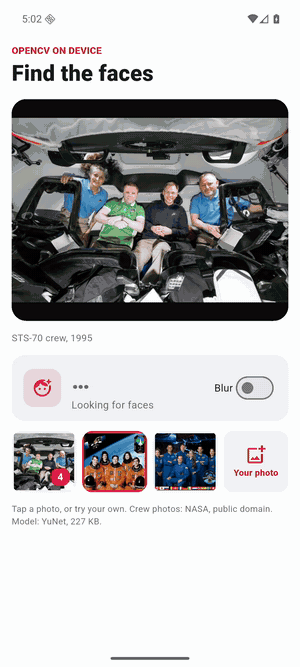
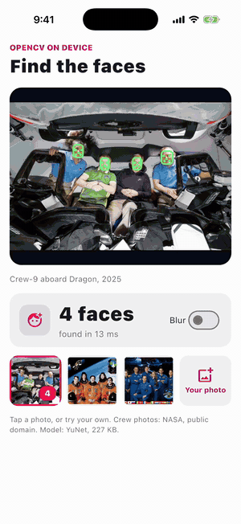
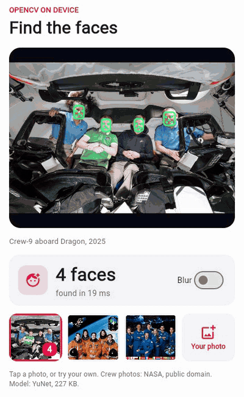

# Face detection

A small AI model finds every face in a photo, and the app draws a green box around each one, with dots on the eyes,
nose tip and mouth corners. One switch blurs the faces, the first step before sharing a photo of people. It all runs
on the device, with no server.

- The model is [YuNet](https://github.com/opencv/opencv_zoo/tree/main/models/face_detection_yunet) from OpenCV Zoo, a
  227 KB ONNX file. It's small, so it comes with the app in `assets/`, next to three sample photos, and the app works
  offline from the first launch. [OpenCV](https://opencv.org)'s `cv2.FaceDetectorYN` runs it: one `detect()` gives
  each face's box, its 5 landmarks and a score, and the app keeps the faces scored 0.8 or more. The model runs in a
  thread (`asyncio.to_thread`), so the app stays responsive, and the card says how many milliseconds it took.
- Each box is a [`Container`](https://flet.dev/docs/controls/container) with a
  [`border`](https://flet.dev/docs/controls/container#flet.Container.border), placed at the face's
  [`left`](https://flet.dev/docs/controls/layoutcontrol#flet.LayoutControl.left) and top in a
  [`Stack`](https://flet.dev/docs/controls/stack) over the photo's [`Image`](https://flet.dev/docs/controls/image).
  The boxes start big and transparent, then pop into place through
  [`animate_scale`](https://flet.dev/docs/controls/layoutcontrol#flet.LayoutControl.animate_scale) and
  [`animate_opacity`](https://flet.dev/docs/controls/layoutcontrol#flet.LayoutControl.animate_opacity).
- **Tap a photo** under the card to find its faces; the count stays on its thumbnail. The boxes follow the photo
  when the window is resized ([`on_resize`](https://flet.dev/docs/controls/basepage#flet.BasePage.on_resize)).
- **Blur** ([`Switch`](https://flet.dev/docs/controls/switch)) blurs every face with `cv2.GaussianBlur()`, on this
  photo and the next ones. `cv2.imencode(".jpg", ...)` gives bytes that the
  [`Image`](https://flet.dev/docs/controls/image) shows as they are (its
  [`src`](https://flet.dev/docs/controls/image#flet.Image.src) takes bytes): no file is written.
- **Your photo** picks one of your own. The tile's
  [`action`](https://flet.dev/docs/controls/actioncontrol#flet.ActionControl.action) is a
  [`PickFiles`](https://flet.dev/docs/types/pickfiles), so the picker opens right in the tap, which browsers (iOS
  Safari above all) require. The photo comes to [`FilePicker`](https://flet.dev/docs/services/filepicker)'s
  [`on_result`](https://flet.dev/docs/services/filepicker#flet.FilePicker.on_result) with its
  [`bytes`](https://flet.dev/docs/types/filepickerfile#flet.FilePickerFile.bytes)
  ([`with_data`](https://flet.dev/docs/types/pickfiles#flet.PickFiles.with_data)), on every platform. Big photos are
  shrunk to 1280 px first. OpenCV reads JPEG and PNG photos, but not HEIC: for a file it can't read, the app says so.

|                                                                Android                                                                 |                                                                 iOS                                                                  |                                                                 Web                                                                  |
|:--------------------------------------------------------------------------------------------------------------------------------------:|:------------------------------------------------------------------------------------------------------------------------------------:|:------------------------------------------------------------------------------------------------------------------------------------:|
|  |  |  |

The same code runs on macOS, Windows and Linux too, in a phone-shaped window (on Windows, an x64 Python: opencv-python
has no build for Windows on Arm). Photos: NASA crew portraits (public domain, [images.nasa.gov](https://images.nasa.gov)):
*NASA's SpaceX Crew-9 members pose together for portrait* (iss072e645414), *STS-70 preflight crew portrait*
(STS070-S-002) and *The official portrait of the seven-member Expedition 75 crew* (iss075-s-002); the photo picked in
the recordings is *Apollo XI - Prime Crew Portrait* (S69-31740). YuNet is MIT-licensed, by Shiqi Yu (its license
is `assets/face_detection_yunet_LICENSE.txt`).

## Run it

With [uv](https://docs.astral.sh/uv/):

```bash
uv run flet run           # desktop
uv run flet run --web     # browser
```

To try it on a phone, [debug](https://flet.dev/docs/cli/flet-debug) it on a connected device or emulator:

```bash
uv run flet debug android   # Android device or emulator
uv run flet debug ios       # iPhone or iOS simulator
```

To share it, [build](https://flet.dev/docs/publish) a package for any platform (desktop apps build on their own OS):

```bash
uv run flet build apk             # Android
uv run flet build ipa             # iOS
uv run flet build ios-simulator   # iOS simulator
uv run flet build macos           # macOS app
uv run flet build windows         # Windows app
uv run flet build linux           # Linux app
```

On Android and iOS, `flet build` takes opencv-python and numpy from [pypi.flet.dev](https://pypi.flet.dev), which has
them built for phones (see [binary packages](https://flet.dev/docs/reference/binary-packages-android-ios)). There's
no static web build (`flet build web`): it runs Python inside the browser with Pyodide, which has its own, older
OpenCV, not the opencv-python 5.0 this app pins. In a browser, serve it with `uv run flet run --web` (or deploy it as
a server app): the faces are then found on the server.

## Learn more

- [Image docs](https://flet.dev/docs/controls/image)
- [Stack](https://flet.dev/docs/controls/stack)
- [Container](https://flet.dev/docs/controls/container)
- [Animation](https://flet.dev/docs/types/animation)
- [Switch](https://flet.dev/docs/controls/switch)
- [FilePicker](https://flet.dev/docs/services/filepicker)
- [PickFiles](https://flet.dev/docs/types/pickfiles)
- [FilePickerFile](https://flet.dev/docs/types/filepickerfile)
- [Binary packages for Android and iOS](https://flet.dev/docs/reference/binary-packages-android-ios)
- [YuNet in OpenCV Zoo](https://github.com/opencv/opencv_zoo/tree/main/models/face_detection_yunet)
