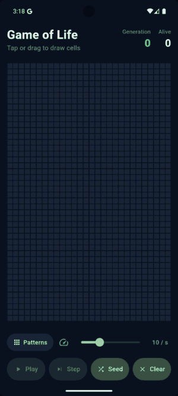
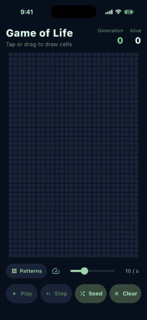
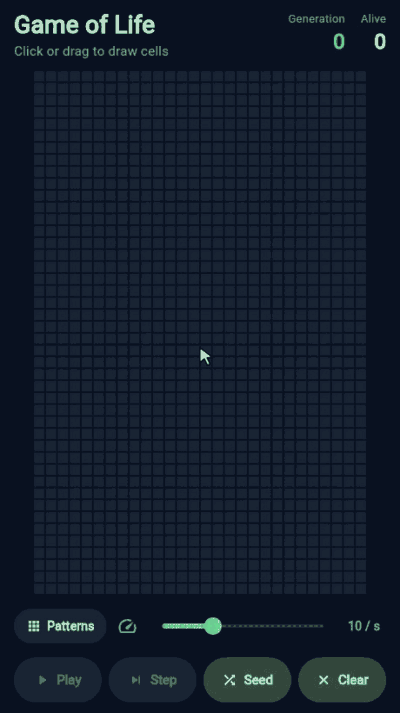

# Game of Life

Conway's Game of Life: a grid of cells and two rules. A dead cell with exactly 3 live neighbors comes alive, and a
live cell with 2 or 3 stays alive; every other cell dies. Draw some cells, press **Play**, and watch them blink, crawl
and grow. NumPy works out each new generation of all 1,232 cells at once, and one
[`Canvas`](https://flet.dev/docs/controls/canvas) draws the board.

- `step()` is the whole rule in a few lines of NumPy: `np.roll` shifts the board one cell in every direction, and the
  sum, minus the cell itself, is every cell's live-neighbor count. `(n == 3) | (grid & (n == 2))` then gives the next
  board. The edges wrap around, so what leaves at the bottom comes back at the top.
- The board is two [`Points`](https://flet.dev/docs/controls/canvas/points) shapes in the canvas
  [`shapes`](https://flet.dev/docs/controls/canvas#flet.canvas.Canvas.shapes): one for every cell, drawn in dark gray,
  and one for the live cells, whose [`points`](https://flet.dev/docs/controls/canvas/points#flet.canvas.Points.points)
  are replaced each generation. With
  [`PointMode.POINTS`](https://flet.dev/docs/types/pointmode#flet.canvas.PointMode.POINTS) and a
  [`SQUARE`](https://flet.dev/docs/types/strokecap#flet.StrokeCap.SQUARE)
  [`stroke_cap`](https://flet.dev/docs/types/paint#flet.Paint.stroke_cap), each point is a square as wide as the
  paint's [`stroke_width`](https://flet.dev/docs/types/paint#flet.Paint.stroke_width), so a frame is one list of
  points instead of a thousand controls.
- The canvas fills the room the screen gives it and tells the app its size through
  [`on_resize`](https://flet.dev/docs/controls/canvas#flet.canvas.Canvas.on_resize). The app picks the largest square
  cell that fits and centers the board, so it stays sharp on a phone, in a resized window or a browser.
- **Tap a cell** to bring it to life or kill it
  ([`on_tap`](https://flet.dev/docs/controls/gesturedetector#flet.GestureDetector.on_tap) of a
  [`GestureDetector`](https://flet.dev/docs/controls/gesturedetector) set as the canvas
  [`content`](https://flet.dev/docs/controls/canvas#flet.canvas.Canvas.content)). **Drag** to draw a line of cells,
  or to erase when the drag starts on a live cell
  ([`on_pan_down`](https://flet.dev/docs/controls/gesturedetector#flet.GestureDetector.on_pan_down),
  [`on_pan_start`](https://flet.dev/docs/controls/gesturedetector#flet.GestureDetector.on_pan_start),
  [`on_pan_update`](https://flet.dev/docs/controls/gesturedetector#flet.GestureDetector.on_pan_update)). A fast drag
  leaves no gaps: the app fills every cell between two updates.
- **Play** runs the generations, from 1 to 30 a second with the
  [`Slider`](https://flet.dev/docs/controls/slider). **Step** makes one generation while paused, **Seed** fills the
  board at random, **Clear** empties it, and **Patterns** ([`PopupMenuButton`](https://flet.dev/docs/controls/popupmenubutton))
  puts a glider, a spaceship, a pulsar or an R-pentomino in the middle. The counters show the generation and the live
  cells, and the game pauses by itself when everything has died.
- The generations come from a small loop started with
  [`run_task`](https://flet.dev/docs/controls/page#flet.Page.run_task). In a browser, it pauses while the page is
  disconnected ([`on_disconnect`](https://flet.dev/docs/controls/page#flet.Page.on_disconnect)), goes on when it
  reconnects ([`on_connect`](https://flet.dev/docs/controls/page#flet.Page.on_connect)) and stops when the session
  ends ([`on_close`](https://flet.dev/docs/controls/page#flet.Page.on_close)), so a closed tab doesn't keep the server
  busy.

|                                                                 Android                                                                 |                                                                  iOS                                                                  |                                                                            Web                                                                             |
|:---------------------------------------------------------------------------------------------------------------------------------------:|:-------------------------------------------------------------------------------------------------------------------------------------:|:----------------------------------------------------------------------------------------------------------------------------------------------------------:|
|  |  |  |

The same code runs on macOS, Windows and Linux too, drawn with the mouse, in a phone-shaped window.

## Run it

With [uv](https://docs.astral.sh/uv/):

```bash
uv run flet run           # desktop
uv run flet run --web     # browser
```

To try it on a phone, [debug](https://flet.dev/docs/cli/flet-debug) it on a connected device or emulator:

```bash
uv run flet debug android   # Android device or emulator
uv run flet debug ios       # iPhone or iOS simulator
```

To share it, [build](https://flet.dev/docs/publish) a package for any platform (desktop apps build on their own OS):

```bash
uv run flet build apk             # Android
uv run flet build ipa             # iOS
uv run flet build ios-simulator   # iOS simulator
uv run flet build macos           # macOS app
uv run flet build windows         # Windows app
uv run flet build linux           # Linux app
uv run flet build web             # static website
```

## Learn more

- [Canvas docs](https://flet.dev/docs/controls/canvas)
- [Points](https://flet.dev/docs/controls/canvas/points)
- [PointMode](https://flet.dev/docs/types/pointmode)
- [Paint](https://flet.dev/docs/types/paint)
- [CanvasResizeEvent](https://flet.dev/docs/types/canvasresizeevent)
- [GestureDetector](https://flet.dev/docs/controls/gesturedetector)
- [TapEvent](https://flet.dev/docs/types/tapevent)
- [DragUpdateEvent](https://flet.dev/docs/types/dragupdateevent)
- [Slider](https://flet.dev/docs/controls/slider)
- [PopupMenuButton](https://flet.dev/docs/controls/popupmenubutton)
