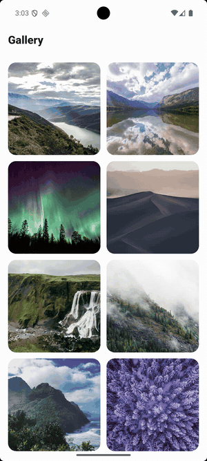
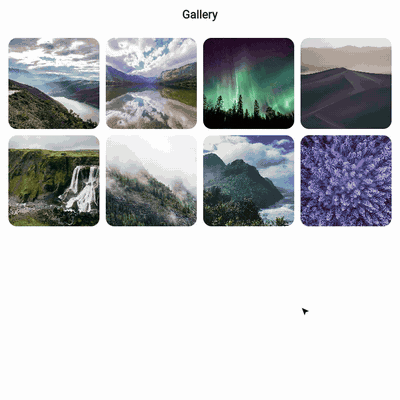

# Hero animation

A photo gallery where each photo flies into its own page and back. Tap a photo: it grows from its spot in the grid
into the full-width photo at the top of the next page. Go back and it shrinks home.

- Each photo in the grid is wrapped in a [`Hero`](https://flet.dev/docs/controls/hero), and the photo page wraps the big photo in a
  `Hero` with the same [`tag`](https://flet.dev/docs/controls/hero#flet.Hero.tag). When the page opens, Flutter flies the photo
  from one to the other; no animation code needed.
- Tapping a photo calls [`page.push_route()`](https://flet.dev/docs/controls/page#flet.Page.push_route) with its route
  (`/photo/aurora.jpg`); the route-change handler builds the list of [`View`](https://flet.dev/docs/controls/view)s for that route.
  The back arrow, Android's back button and the iOS back swipe go through
  [`on_view_pop`](https://flet.dev/docs/controls/page#flet.Page.on_view_pop).
- The grid is a [`GridView`](https://flet.dev/docs/controls/gridview) with
  [`max_extent`](https://flet.dev/docs/controls/gridview#flet.GridView.max_extent): two columns on a phone, more on a wider window.
- The eight photos ship with the app in `assets/`, so it works offline.

|                                                     Android                                                     |                                                      iOS                                                      |                                                      Web                                                      |
|:---------------------------------------------------------------------------------------------------------------:|:-------------------------------------------------------------------------------------------------------------:|:-------------------------------------------------------------------------------------------------------------:|
|  |  |  |

The same code runs on macOS, Windows and Linux too. Photos from Wikimedia Commons, CC0 (originally on Unsplash):
*Road along the fjord* by Danny Froese, *Clouds mirrored in a mountain lake* by Ales Krivec, *Polar lights over dark
trees* by Vincent Guth, *Desert Dunes* by Joe Mania, *Mossy rock mountain and waterfall* by Jacek Smoter, *Misty
coniferous forest on a slope* by Jon Flobrant, *NaPali Coast* by Josh Austin, *Frozen Forest* by invisiblepower.

## Run it

With [uv](https://docs.astral.sh/uv/):

```bash
uv run flet run           # desktop
uv run flet run --web     # browser
```

To try it on a phone, [debug](https://flet.dev/docs/cli/flet-debug) it on a connected device or emulator:

```bash
uv run flet debug android   # Android device or emulator
uv run flet debug ios       # iPhone or iOS simulator
```

To share it, [build](https://flet.dev/docs/publish) a package for any platform (desktop apps build on their own OS):

```bash
uv run flet build apk             # Android
uv run flet build ipa             # iOS
uv run flet build ios-simulator   # iOS simulator
uv run flet build macos           # macOS app
uv run flet build windows         # Windows app
uv run flet build linux           # Linux app
uv run flet build web             # static website
```
## Learn more

- [Hero docs](https://flet.dev/docs/controls/hero)
- [Navigation and routing](https://flet.dev/docs/cookbook/navigation-and-routing)
- [View](https://flet.dev/docs/controls/view)
- [GridView](https://flet.dev/docs/controls/gridview)
