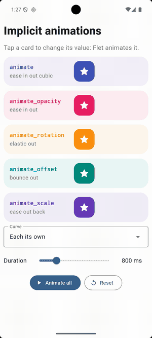
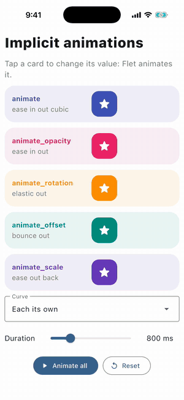
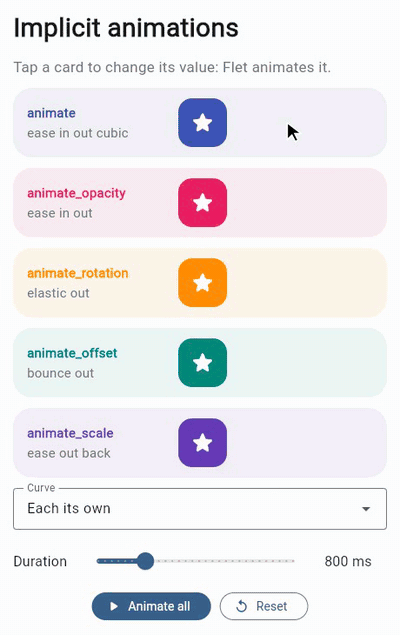

# Implicit animations

Set a new value on a control and it glides there instead of jumping. Five star boxes show five ways to move: they
grow and change color, fade, spin, slide and zoom. Pick a curve and a duration to see how each one changes the motion.

- **Tap a card** to flip its box between two values, and tap again to send it back. Each box has its animation
  switched on once, with an [`Animation`](https://flet.dev/docs/types/animation) (a
  [`duration`](https://flet.dev/docs/types/animation#flet.Animation.duration) in milliseconds and a
  [`curve`](https://flet.dev/docs/types/animation#flet.Animation.curve)); after that, the app only sets the new value
  and calls `page.update()`, and Flet draws the frames in between:
  - a [`Container`](https://flet.dev/docs/controls/container)'s own
    [`animate`](https://flet.dev/docs/controls/container#flet.Container.animate) covers its
    [`width`](https://flet.dev/docs/controls/layoutcontrol#flet.LayoutControl.width) and
    [`bgcolor`](https://flet.dev/docs/controls/container#flet.Container.bgcolor) at once,
  - [`animate_opacity`](https://flet.dev/docs/controls/layoutcontrol#flet.LayoutControl.animate_opacity) fades
    [`opacity`](https://flet.dev/docs/controls/control#flet.Control.opacity),
  - [`animate_rotation`](https://flet.dev/docs/controls/layoutcontrol#flet.LayoutControl.animate_rotation) turns
    [`rotate`](https://flet.dev/docs/controls/layoutcontrol#flet.LayoutControl.rotate) half a turn with a springy
    [`ELASTIC_OUT`](https://flet.dev/docs/types/animationcurve#flet.AnimationCurve.ELASTIC_OUT) finish,
  - [`animate_offset`](https://flet.dev/docs/controls/layoutcontrol#flet.LayoutControl.animate_offset) slides
    [`offset`](https://flet.dev/docs/controls/layoutcontrol#flet.LayoutControl.offset) to the right with a
    [`BOUNCE_OUT`](https://flet.dev/docs/types/animationcurve#flet.AnimationCurve.BOUNCE_OUT),
  - [`animate_scale`](https://flet.dev/docs/controls/layoutcontrol#flet.LayoutControl.animate_scale) zooms
    [`scale`](https://flet.dev/docs/controls/layoutcontrol#flet.LayoutControl.scale).
- **Curve** is a [`Dropdown`](https://flet.dev/docs/controls/dropdown) with every
  [`AnimationCurve`](https://flet.dev/docs/types/animationcurve): leave it on "Each its own" to keep one curve per
  card, or pick one for all five ([`on_select`](https://flet.dev/docs/controls/dropdown#flet.Dropdown.on_select)).
- **Duration** is a [`Slider`](https://flet.dev/docs/controls/slider) from 100 to 3000 ms. The menu and the slider
  move nothing by themselves: each box picks up the curve and duration on its next change.
- **Animate all** sends every box to its end value at once, and **Reset** sends them all back.

|                                                                           Android                                                                           |                                                                            iOS                                                                            |                                                                                  Web                                                                                  |
|:-----------------------------------------------------------------------------------------------------------------------------------------------------------:|:---------------------------------------------------------------------------------------------------------------------------------------------------------:|:---------------------------------------------------------------------------------------------------------------------------------------------------------------------:|
|  |  |  |

The same code runs on macOS, Windows and Linux too, with a click instead of a tap.

## Run it

With [uv](https://docs.astral.sh/uv/):

```bash
uv run flet run           # desktop
uv run flet run --web     # browser
```

To try it on a phone, [debug](https://flet.dev/docs/cli/flet-debug) it on a connected device or emulator:

```bash
uv run flet debug android   # Android device or emulator
uv run flet debug ios       # iPhone or iOS simulator
```

To share it, [build](https://flet.dev/docs/publish) a package for any platform (desktop apps build on their own OS):

```bash
uv run flet build apk             # Android
uv run flet build ipa             # iOS
uv run flet build ios-simulator   # iOS simulator
uv run flet build macos           # macOS app
uv run flet build windows         # Windows app
uv run flet build linux           # Linux app
uv run flet build web             # static website
```

## Learn more

- [Animations cookbook](https://flet.dev/docs/cookbook/animations)
- [Animation](https://flet.dev/docs/types/animation)
- [AnimationCurve](https://flet.dev/docs/types/animationcurve)
- [Container](https://flet.dev/docs/controls/container)
- [Dropdown](https://flet.dev/docs/controls/dropdown)
- [Slider](https://flet.dev/docs/controls/slider)
