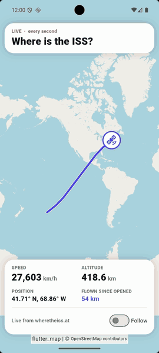
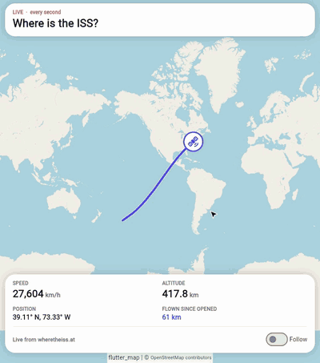

# ISS tracker

Where is the International Space Station right now? This app asks the free
[wheretheiss.at](https://wheretheiss.at) API every second and shows the answer live on a
[flet-map](https://flet.dev/docs/controls/map) map:

- The station is a [`Marker`](https://flet.dev/docs/controls/map/marker); every answer moves its
  [`coordinates`](https://flet.dev/docs/controls/map/marker#flet_map.Marker.coordinates).
- Its trail is a [`PolylineMarker`](https://flet.dev/docs/controls/map/polylinemarker) that grows by one point each
  second. When the app opens, the trail starts with the station's last 30 minutes, from the same API.
- A card shows its speed (about 27,600 km/h), altitude, position and how far it has flown since the app opened.
- **Follow** flies the map down to the station and keeps it in view with
  [`move_to()`](https://flet.dev/docs/controls/map/mapcontrol#flet_map.Map.move_to); switch it off to zoom back out
  to the whole trail. You can also drag and zoom the map yourself.

The network call runs in a thread (`asyncio.to_thread`), so the app never freezes while it waits. The loop is a
[`page.run_task()`](https://flet.dev/docs/controls/page#flet.Page.run_task) task, and in a browser it pauses when the
tab closes ([`on_disconnect`](https://flet.dev/docs/controls/page#flet.Page.on_disconnect)) and stops when the
session ends ([`on_close`](https://flet.dev/docs/controls/page#flet.Page.on_close)).

|                                                            Android                                                             |                                                          iOS                                                          |
|:------------------------------------------------------------------------------------------------------------------------------:|:---------------------------------------------------------------------------------------------------------------------:|
|  |  |

|                                                                    Web                                                                    |
|:-----------------------------------------------------------------------------------------------------------------------------------------:|
|  |

The same code runs on macOS, Windows and Linux too. Position data from
[wheretheiss.at](https://wheretheiss.at), map © [OpenStreetMap](https://www.openstreetmap.org/copyright) contributors.

## Run it

With [uv](https://docs.astral.sh/uv/):

```bash
uv run flet run           # desktop
uv run flet run --web     # browser
```

To try it on a phone, [debug](https://flet.dev/docs/cli/flet-debug) it on a connected device or emulator:

```bash
uv run flet debug android   # Android device or emulator
uv run flet debug ios       # iPhone or iOS simulator
```

To share it, [build](https://flet.dev/docs/publish) a package for any platform (desktop apps build on their own OS):

```bash
uv run flet build apk       # Android
uv run flet build ipa       # iOS
uv run flet build macos     # macOS app
uv run flet build windows   # Windows app
uv run flet build linux     # Linux app
```

There's no static web build (`flet build web`): it runs Python inside the browser, where the app can't open its own
HTTPS connection to the API. In a browser, serve it with `uv run flet run --web` (or deploy it as a server app).

## Learn more

- [Map docs](https://flet.dev/docs/controls/map)
- [Marker](https://flet.dev/docs/controls/map/marker)
- [PolylineLayer](https://flet.dev/docs/controls/map/polylinelayer)
- [PolylineMarker](https://flet.dev/docs/controls/map/polylinemarker)
- [wheretheiss.at API](https://wheretheiss.at/w/developer)
