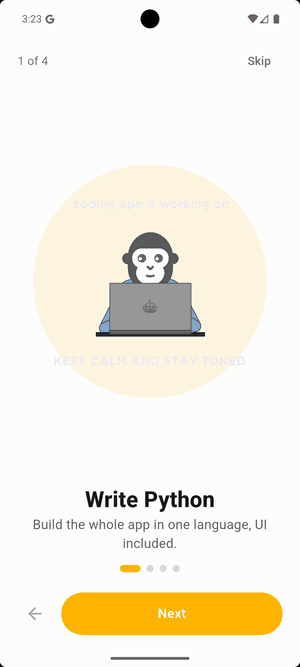
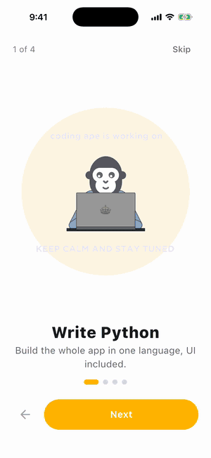
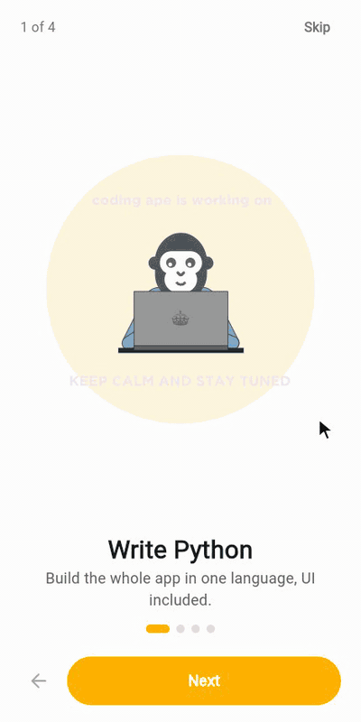

# Lottie onboarding

An onboarding flow of four pages, each with its own looping Lottie animation, played straight from a web link with
[flet-lottie](https://flet.dev/docs/controls/lottie). Lottie files are small animations that designers export as
JSON, so a screen can move without drawing a single frame in code. Swipe through the pages, skip them, and land on a
welcome screen.

- Each animation is a [`Lottie`](https://flet.dev/docs/controls/lottie) control whose
  [`src`](https://flet.dev/docs/controls/lottie#flet_lottie.Lottie.src) is the URL of a `.json` file on GitHub.
  [`repeat=True`](https://flet.dev/docs/controls/lottie#flet_lottie.Lottie.repeat) loops it, and `width`, `height`
  and [`fit`](https://flet.dev/docs/controls/lottie#flet_lottie.Lottie.fit) size it.
- The four animations sit on top of each other in a [`Stack`](https://flet.dev/docs/controls/stack), each in a
  [`Container`](https://flet.dev/docs/controls/container) with
  [`animate_opacity`](https://flet.dev/docs/controls/layoutcontrol#flet.LayoutControl.animate_opacity) and
  [`animate_offset`](https://flet.dev/docs/controls/layoutcontrol#flet.LayoutControl.animate_offset). Changing pages
  sets their [`opacity`](https://flet.dev/docs/controls/control#flet.Control.opacity) and
  [`offset`](https://flet.dev/docs/controls/layoutcontrol#flet.LayoutControl.offset), so the new one slides and fades
  in while the old one leaves the other way. The circle behind it, the page dots and the button change color with
  [`animate`](https://flet.dev/docs/controls/container#flet.Container.animate).
- The pages you can't see get
  [`animate=False`](https://flet.dev/docs/controls/lottie#flet_lottie.Lottie.animate): they pause on their current
  frame and use no CPU, and pick up from there when they come back.
- **Swipe** left or right (with a finger, or by dragging the mouse): a
  [`GestureDetector`](https://flet.dev/docs/controls/gesturedetector) compares where the drag
  [starts](https://flet.dev/docs/controls/gesturedetector#flet.GestureDetector.on_horizontal_drag_start) and
  [ends](https://flet.dev/docs/controls/gesturedetector#flet.GestureDetector.on_horizontal_drag_end). **Next** and the
  back arrow do the same, and so do the left and right arrow keys
  ([`on_keyboard_event`](https://flet.dev/docs/controls/page#flet.Page.on_keyboard_event)). Tap a **page dot** to jump
  to its page, or **Skip** to the last one.
- **Get started** on the last page swaps the flow for a welcome screen with an
  [`AnimatedSwitcher`](https://flet.dev/docs/controls/animatedswitcher). Its check mark has `repeat=False`, so it plays
  once and stays on its last frame. **See the intro again** goes back to the first page.
- Offline, or when a link breaks, each Lottie shows its
  [`error_content`](https://flet.dev/docs/controls/lottie#flet_lottie.Lottie.error_content) instead: a cloud icon and
  "Couldn't load the animation".

|                                                                                 Android                                                                                 |                                                                                  iOS                                                                                  |                                                                      Web                                                                      |
|:-----------------------------------------------------------------------------------------------------------------------------------------------------------------------:|:---------------------------------------------------------------------------------------------------------------------------------------------------------------------:|:---------------------------------------------------------------------------------------------------------------------------------------------:|
|  |  |  |

The same code runs on macOS, Windows and Linux too, in a phone-shaped column centered in the window. The animations
are from the example set of the [lottie-flutter](https://github.com/xvrh/lottie-flutter) package (MIT license),
loaded from its GitHub repository, so the app needs an internet connection to show them.

## Run it

With [uv](https://docs.astral.sh/uv/):

```bash
uv run flet run           # desktop
uv run flet run --web     # browser
```

To try it on a phone, [debug](https://flet.dev/docs/cli/flet-debug) it on a connected device or emulator:

```bash
uv run flet debug android   # Android device or emulator
uv run flet debug ios       # iPhone or iOS simulator
```

To share it, [build](https://flet.dev/docs/publish) a package for any platform (desktop apps build on their own OS):

```bash
uv run flet build apk             # Android
uv run flet build ipa             # iOS
uv run flet build ios-simulator   # iOS simulator
uv run flet build macos           # macOS app
uv run flet build windows         # Windows app
uv run flet build linux           # Linux app
uv run flet build web             # static website
```

## Learn more

- [Lottie docs](https://flet.dev/docs/controls/lottie)
- [GestureDetector](https://flet.dev/docs/controls/gesturedetector)
- [AnimatedSwitcher](https://flet.dev/docs/controls/animatedswitcher)
- [Container](https://flet.dev/docs/controls/container)
- [Animation](https://flet.dev/docs/types/animation)
- [DragEndEvent](https://flet.dev/docs/types/dragendevent)
