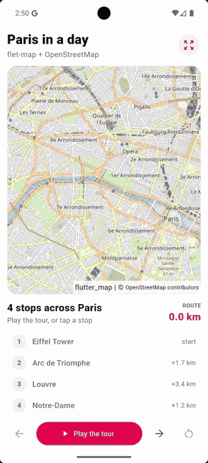
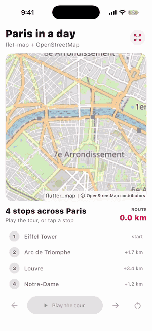
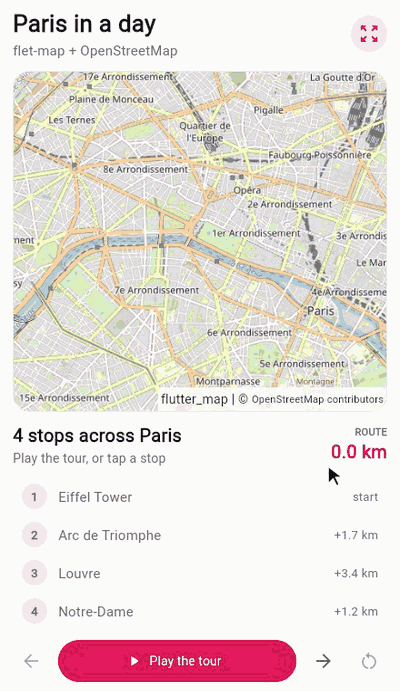

# Map tour

Paris in a day, on a [flet-map](https://flet.dev/docs/controls/map) map with OpenStreetMap streets: four stops, from
the Eiffel Tower to Notre-Dame. Walk the tour stop by stop or let it play, and watch the route grow as the map flies
from one stop to the next.

- **Play the tour** walks through the stops by itself, with a short pause at each, then zooms out to the whole
  route. **Pause** stops it at the next stop; **Play again** starts over.
- At each stop, the route line grows from the stop before: it's a
  [`PolylineMarker`](https://flet.dev/docs/controls/map/polylinemarker) whose
  [`coordinates`](https://flet.dev/docs/controls/map/polylinemarker#flet_map.PolylineMarker.coordinates) get ten
  points closer to the stop, one update at a time. Meanwhile
  [`move_to()`](https://flet.dev/docs/controls/map/mapcontrol#flet_map.Map.move_to) flies the map to the middle of
  that leg, over 800 ms ([`animation_duration`](https://flet.dev/docs/controls/map/mapcontrol#flet_map.Map.animation_duration)).
- Then the stop's numbered pin pops in. Each pin is a [`Marker`](https://flet.dev/docs/controls/map/marker) whose
  [`content`](https://flet.dev/docs/controls/map/marker#flet_map.Marker.content) is a round
  [`Container`](https://flet.dev/docs/controls/container): it turns
  [`visible`](https://flet.dev/docs/controls/map/marker#flet_map.Marker.visible), and its
  [`scale`](https://flet.dev/docs/controls/layoutcontrol#flet.LayoutControl.scale) goes from 0 to 1 with an
  [`EASE_OUT_BACK`](https://flet.dev/docs/types/animationcurve#flet.AnimationCurve.EASE_OUT_BACK)
  [`animate_scale`](https://flet.dev/docs/controls/layoutcontrol#flet.LayoutControl.animate_scale), so it overshoots
  a little and settles.
- **Next** and **Previous** walk one stop forward or back: going back takes the last pin away and shrinks the line
  to the stop before. **Start over** clears the route.
- **Tap a pin** on the map ([`on_click`](https://flet.dev/docs/controls/container#flet.Container.on_click)) **or a
  stop in the list** to fly down to it. Tapping a stop the tour hasn't reached yet walks on to it.
- The card adds up the route's length, leg by leg, in straight lines between the stops (the haversine formula).
- The corner button zooms out to the whole route. You can also drag and zoom the map yourself; rotating is off
  ([`interaction_configuration`](https://flet.dev/docs/controls/map/mapcontrol#flet_map.Map.interaction_configuration)),
  so north stays up.
- On desktop and web, the **left and right arrow keys** work as Previous and Next
  ([`on_keyboard_event`](https://flet.dev/docs/controls/page#flet.Page.on_keyboard_event)).

The streets come from OpenStreetMap's tile server
([`url_template`](https://flet.dev/docs/controls/map/tilelayer#flet_map.TileLayer.url_template)). The app names
itself to it with
[`user_agent_package_name`](https://flet.dev/docs/controls/map/tilelayer#flet_map.TileLayer.user_agent_package_name),
as the [tile usage policy](https://operations.osmfoundation.org/policies/tiles/) asks, and credits it with a
[`SimpleAttribution`](https://flet.dev/docs/controls/map/simpleattribution) that opens the OpenStreetMap copyright
page when clicked ([`on_click`](https://flet.dev/docs/controls/map/simpleattribution#flet_map.SimpleAttribution.on_click)).

|                                                          Android                                                          |                                                                          iOS                                                                           |                                                 Web                                                 |
|:-------------------------------------------------------------------------------------------------------------------------:|:------------------------------------------------------------------------------------------------------------------------------------------------------:|:---------------------------------------------------------------------------------------------------:|
|  |  |  |

The same code runs on macOS, Windows and Linux too. Map © [OpenStreetMap](https://www.openstreetmap.org/copyright)
contributors.

## Run it

With [uv](https://docs.astral.sh/uv/):

```bash
uv run flet run           # desktop
uv run flet run --web     # browser
```

To try it on a phone, [debug](https://flet.dev/docs/cli/flet-debug) it on a connected device or emulator:

```bash
uv run flet debug android   # Android device or emulator
uv run flet debug ios       # iPhone or iOS simulator
```

To share it, [build](https://flet.dev/docs/publish) a package for any platform (desktop apps build on their own OS):

```bash
uv run flet build apk             # Android
uv run flet build ipa             # iOS
uv run flet build ios-simulator   # iOS simulator
uv run flet build macos           # macOS app
uv run flet build windows         # Windows app
uv run flet build linux           # Linux app
uv run flet build web             # static website
```

## Learn more

- [Map docs](https://flet.dev/docs/controls/map)
- [Marker](https://flet.dev/docs/controls/map/marker)
- [MarkerLayer](https://flet.dev/docs/controls/map/markerlayer)
- [PolylineMarker](https://flet.dev/docs/controls/map/polylinemarker)
- [PolylineLayer](https://flet.dev/docs/controls/map/polylinelayer)
- [TileLayer](https://flet.dev/docs/controls/map/tilelayer)
- [SimpleAttribution](https://flet.dev/docs/controls/map/simpleattribution)
- [InteractionConfiguration](https://flet.dev/docs/controls/map/types/interactionconfiguration)
