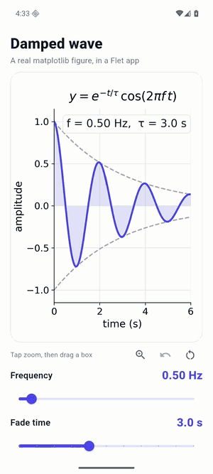
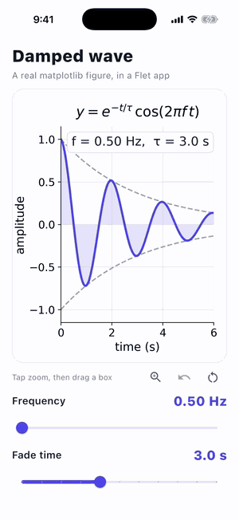
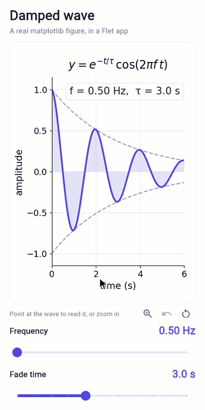

# Matplotlib charts

A real [matplotlib](https://matplotlib.org) figure inside a Flet app: a damped wave, drawn with plain `plt.subplots()`,
`ax.plot()` and a math title, and shown by flet-charts'
[`MatplotlibChart`](https://flet.dev/docs/controls/charts/matplotlibchart). Drag a slider and the figure redraws while
your finger or mouse moves.

- **Frequency** and **Fade time** are two [`Slider`](https://flet.dev/docs/controls/slider)s. On every
  [`on_change`](https://flet.dev/docs/controls/slider#flet.Slider.on_change), the app gives the lines new data
  (`line.set_ydata(...)`, computed with NumPy) and calls `fig.canvas.draw_idle()`: the chart renders a new frame. When
  the slider moves faster than frames arrive, the chart skips to the newest state instead of piling them up.
- **Point at the wave** (desktop, web): the text under the chart reads the time and value under the pointer. On a
  phone, it follows your finger while you drag a zoom box. The text comes from matplotlib itself, through the chart's
  [`on_message`](https://flet.dev/docs/controls/charts/matplotlibchart#flet_charts.matplotlib_chart.MatplotlibChart.on_message).
- **Zoom**: the magnifier turns on matplotlib's zoom tool
  ([`zoom()`](https://flet.dev/docs/controls/charts/matplotlibchart#flet_charts.matplotlib_chart.MatplotlibChart.zoom)).
  Drag a box over the wave, with a finger or the mouse, and the axes zoom in on it. The sliders keep working on the
  zoomed view.
- **Previous view** steps back through your zooms
  ([`back()`](https://flet.dev/docs/controls/charts/matplotlibchart#flet_charts.matplotlib_chart.MatplotlibChart.back));
  it is enabled only when there is a view to go back to
  ([`on_toolbar_buttons_update`](https://flet.dev/docs/controls/charts/matplotlibchart#flet_charts.matplotlib_chart.MatplotlibChart.on_toolbar_buttons_update)).
  **Reset** puts the sliders back and shows the full figure again
  ([`home()`](https://flet.dev/docs/controls/charts/matplotlibchart#flet_charts.matplotlib_chart.MatplotlibChart.home)).
- On a new device, matplotlib's first import builds a font cache, which can take half a minute. The app shows a
  "Loading matplotlib…" status meanwhile, and on phones it keeps the cache in the app's storage, so later launches
  start at once.

|                                                              Android                                                               |                                                              iOS                                                               |                                                                  Web                                                                   |
|:----------------------------------------------------------------------------------------------------------------------------------:|:------------------------------------------------------------------------------------------------------------------------------:|:--------------------------------------------------------------------------------------------------------------------------------------:|
|  |  |  |

The same code runs on macOS, Windows and Linux too.

## Run it

With [uv](https://docs.astral.sh/uv/):

```bash
uv run flet run           # desktop
uv run flet run --web     # browser
```

To try it on a phone, [debug](https://flet.dev/docs/cli/flet-debug) it on a connected device or emulator:

```bash
uv run flet debug android   # Android device or emulator
uv run flet debug ios       # iPhone or iOS simulator
```

To share it, [build](https://flet.dev/docs/publish) a package for any platform (desktop apps build on their own OS):

```bash
uv run flet build apk             # Android
uv run flet build ipa             # iOS
uv run flet build ios-simulator   # iOS simulator
uv run flet build macos           # macOS app
uv run flet build windows         # Windows app
uv run flet build linux           # Linux app
```

On Android and iOS, `flet build` takes matplotlib and NumPy from [pypi.flet.dev](https://pypi.flet.dev), which has
them built for phones (see [binary packages](https://flet.dev/docs/reference/binary-packages-android-ios)). On
Android, `pyproject.toml` lists matplotlib in
[`extract_packages`](https://flet.dev/docs/publish/android#extract-packages), because it reads its fonts and settings
from files next to its code.

For a static website (`uv run flet build web`), set `matplotlib==3.10.8` in `pyproject.toml` first: the website
runs Python in the browser with [Pyodide](https://pyodide.org), which ships matplotlib 3.10.8, while the phone builds
need 3.10.9. Or serve it as it is with `uv run flet run --web`.

## Learn more

- [MatplotlibChart docs](https://flet.dev/docs/controls/charts/matplotlibchart)
- [MatplotlibChartWithToolbar](https://flet.dev/docs/controls/charts/matplotlibchartwithtoolbar), the same chart with
  a ready-made toolbar
- [Slider](https://flet.dev/docs/controls/slider)
- [IconButton](https://flet.dev/docs/controls/iconbutton)
- [matplotlib's user guide](https://matplotlib.org/stable/users/index.html)
