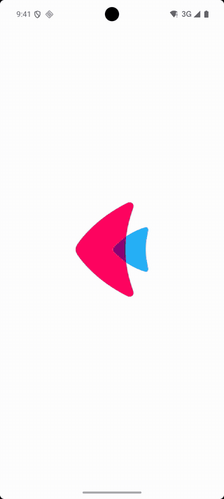

# Notification action buttons

A notification with **Snooze** and **Mark done** buttons. Tapping a button calls a Python function
([`on_action`](https://flet.dev/docs/services/notifications#flet_notifications.Notifications.on_action)),
which learns which button was tapped ([`e.action_id`](https://flet.dev/docs/services/notifications/types/notificationactionevent#flet_notifications.NotificationActionEvent.action_id))
and which task it belongs to ([`e.payload`](https://flet.dev/docs/services/notifications/types/notificationevent#flet_notifications.NotificationEvent.payload)):

- **Mark done** crosses the task out in the app.
- **Snooze** shows the notification again 10 seconds later.

| Android |
| :---: |
|  |

The same code runs on iOS, macOS and Windows. On Linux and the web, the buttons appear where the system supports them.

## Run it

With [uv](https://docs.astral.sh/uv/):

```bash
uv run flet run           # desktop
uv run flet run --web     # browser
```

To try it on a phone, [debug](https://flet.dev/docs/cli/flet-debug) it on a connected device or emulator:

```bash
uv run flet debug android   # Android device or emulator
uv run flet debug ios       # iPhone or iOS simulator
```

To share it, [build](https://flet.dev/docs/publish) a package for any platform (desktop apps build on their own OS):

```bash
uv run flet build apk       # Android
uv run flet build ipa       # iOS
uv run flet build macos     # macOS app
uv run flet build windows   # Windows app
uv run flet build linux     # Linux app
uv run flet build web       # static website
```

## Learn more

- [Notifications docs](https://flet.dev/docs/services/notifications)
- [`NotificationAction`](https://flet.dev/docs/services/notifications/types/notificationaction): every option a notification button has
