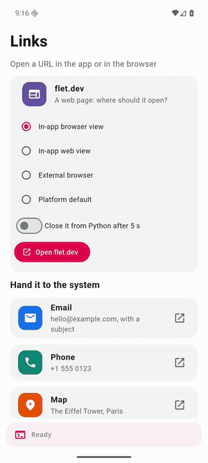
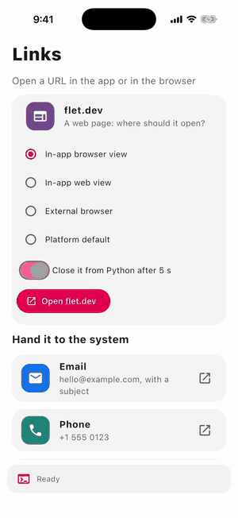
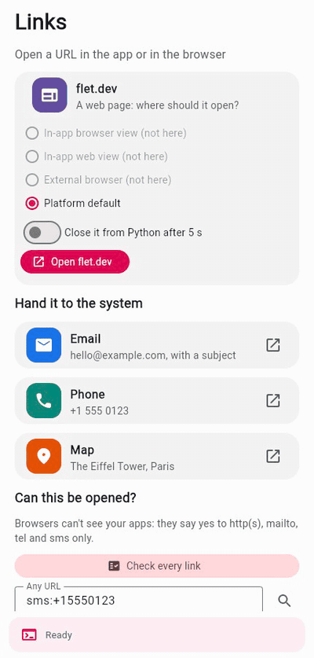

# Open links

Some links should open without leaving your app, like help pages or terms of use; others belong in the phone's
browser, mail app, dialer or maps. This app does both from Python with Flet's built-in
[`UrlLauncher`](https://flet.dev/docs/services/urllauncher), and asks the platform which links it can open at all.
The bar at the bottom shows each call and how it went.

- **flet.dev** opens with
  [`launch_url()`](https://flet.dev/docs/services/urllauncher#flet.UrlLauncher.launch_url) in the
  [`LaunchMode`](https://flet.dev/docs/types/launchmode) you pick:
  [`IN_APP_BROWSER_VIEW`](https://flet.dev/docs/types/launchmode#flet.LaunchMode.IN_APP_BROWSER_VIEW) (a Safari view
  on iPhone, a Custom Tab on Android, with the page
  [title](https://flet.dev/docs/types/browserconfiguration#flet.BrowserConfiguration.show_title) shown),
  [`IN_APP_WEB_VIEW`](https://flet.dev/docs/types/launchmode#flet.LaunchMode.IN_APP_WEB_VIEW),
  [`EXTERNAL_APPLICATION`](https://flet.dev/docs/types/launchmode#flet.LaunchMode.EXTERNAL_APPLICATION) (the default
  browser) or [`PLATFORM_DEFAULT`](https://flet.dev/docs/types/launchmode#flet.LaunchMode.PLATFORM_DEFAULT). At start,
  the app asks [`supports_launch_mode()`](https://flet.dev/docs/services/urllauncher#flet.UrlLauncher.supports_launch_mode)
  about each mode and grays out the ones the platform doesn't offer.
- **Close it from Python after 5 s** closes the in-app view again with
  [`close_in_app_web_view()`](https://flet.dev/docs/services/urllauncher#flet.UrlLauncher.close_in_app_web_view),
  from a task started with [`page.run_task()`](https://flet.dev/docs/controls/page#flet.Page.run_task). The switch
  is on only for modes where
  [`supports_close_for_launch_mode()`](https://flet.dev/docs/services/urllauncher#flet.UrlLauncher.supports_close_for_launch_mode)
  says yes: both in-app modes on iPhone, only the in-app web view on Android (people close a Custom Tab themselves,
  with Back).
- **Email**, **Phone** and **Map** hand a link to the app that handles it, with `EXTERNAL_APPLICATION`: a `mailto:`
  link with a subject and a body, a `tel:` number, and the Eiffel Tower in the platform's maps (a `geo:` link on
  Android, Apple Maps on iPhone and macOS, Google Maps elsewhere). A ✓ means the call went through: the platform
  doesn't say whether an app picked the link up.
- **Check every link** asks [`can_launch_url()`](https://flet.dev/docs/services/urllauncher#flet.UrlLauncher.can_launch_url)
  about the web page, the three links and a WhatsApp link, and lists each yes or no. Type any URL in the field to
  check it too. The answers are honest per platform, and a note above the button says what a "no" means there.

| Android | iOS | Web |
| :---: | :---: | :---: |
|  |  |  |

The same code runs on macOS, Windows and Linux too, in a phone-shaped column: there the links open in the default
browser and apps, and the in-app modes are grayed out. In a browser only `PLATFORM_DEFAULT` is offered, and every
link opens in a new tab. The buttons carry an [`OpenUrl`](https://flet.dev/docs/types/openurl) client action in their
[`action`](https://flet.dev/docs/controls/actioncontrol#flet.ActionControl.action) there
([`page.web`](https://flet.dev/docs/controls/page#flet.Page.web) decides): browsers open a tab only while they handle
a click, so the browser opens it right away, before Python hears about the click (iOS Safari would ignore a
`launch_url()` that arrives later).

### Why `can_launch_url()` says no

Phones answer only about the schemes an app declares, so
[`pyproject.toml`](pyproject.toml) declares every scheme the app checks: in
[`[tool.flet.android.queries]`](https://flet.dev/docs/publish/android#queries) for Android 11+ (plus Custom Tabs, which
`IN_APP_BROWSER_VIEW` needs there) and in `LSApplicationQueriesSchemes` of
[`[tool.flet.ios.info]`](https://flet.dev/docs/publish/ios#infoplist) for iOS. Without them, Android and iOS say no
even when an app is installed; with them, a no means that no app on the device handles the link (the iOS simulator
has no Mail or Phone app, and the Android emulator may have no maps app). Desktops ask the system for an app
registered for the scheme, and browsers can't see your apps at all: they say yes to `http(s)`, `mailto`, `tel` and
`sms` only.

## Run it

With [uv](https://docs.astral.sh/uv/):

```bash
uv run flet run           # desktop
uv run flet run --web     # browser
```

To try it on a phone, [debug](https://flet.dev/docs/cli/flet-debug) it on a connected device or emulator:

```bash
uv run flet debug android   # Android device or emulator
uv run flet debug ios       # iPhone or iOS simulator
```

To share it, [build](https://flet.dev/docs/publish) a package for any platform (desktop apps build on their own OS):

```bash
uv run flet build apk             # Android
uv run flet build ipa             # iOS
uv run flet build ios-simulator   # iOS simulator
uv run flet build macos           # macOS app
uv run flet build windows         # Windows app
uv run flet build linux           # Linux app
uv run flet build web             # static website
```

## Learn more

- [UrlLauncher docs](https://flet.dev/docs/services/urllauncher)
- [LaunchMode](https://flet.dev/docs/types/launchmode)
- [BrowserConfiguration](https://flet.dev/docs/types/browserconfiguration)
- [OpenUrl](https://flet.dev/docs/types/openurl)
- [RadioGroup](https://flet.dev/docs/controls/radiogroup)
- [ListTile](https://flet.dev/docs/controls/listtile)
