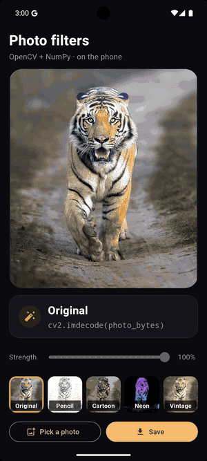
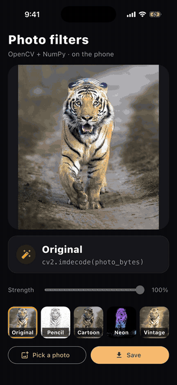
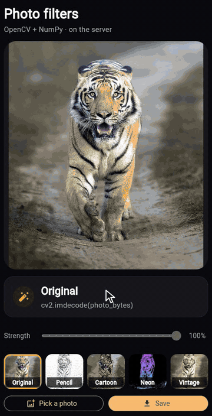

# Photo filters

Turn a photo into a pencil sketch, a cartoon, glowing neon edges or an old sepia print. The filters are a few lines
of image math with [OpenCV](https://opencv.org) and [NumPy](https://numpy.org), and they run inside the app: no AI
model, no server, no upload.

- The sample photo, a tiger, comes with the app in `assets/`, so it works offline from the first launch. The app
  runs every filter on the photo once, in a thread (`asyncio.to_thread`), while the photo area shows "Applying
  filters...". After that, switching filters is instant.
- **Pencil sketch** divides a gray copy of the photo by a blurred, inverted copy (`cv2.divide()`), so flat areas turn
  white and only the lines stay. **Cartoon** smooths the colors with `cv2.bilateralFilter()`, cuts them to a few
  levels and draws black outlines from `cv2.adaptiveThreshold()`. **Neon edges** are `cv2.Canny()` edges with a soft
  glow, colored by a NumPy gradient. **Vintage** is a sepia color matrix (`cv2.transform()`) and a vignette.
- `cv2.imencode(".jpg", ...)` gives bytes that an [`Image`](https://flet.dev/docs/controls/image) shows as they are
  (its [`src`](https://flet.dev/docs/controls/image#flet.Image.src) takes bytes): no file is written. The photo sits
  in an [`AnimatedSwitcher`](https://flet.dev/docs/controls/animatedswitcher), so every new look
  [fades](https://flet.dev/docs/controls/animatedswitcher#flet.AnimatedSwitcher.transition) in.
- **Tap a tile** in the filter strip to apply its filter, or **Original** to go back. Each tile shows a small preview
  of its look as the [`image`](https://flet.dev/docs/controls/container#flet.Container.image) of a
  [`Container`](https://flet.dev/docs/controls/container). On desktop and web, the **left and right arrow keys** switch
  filters too ([`on_keyboard_event`](https://flet.dev/docs/controls/page#flet.Page.on_keyboard_event)).
- **Strength** mixes the filter over the original photo (`cv2.addWeighted()`), from 0 to 100%. The
  [`Slider`](https://flet.dev/docs/controls/slider) shows the value in its
  [`label`](https://flet.dev/docs/controls/slider#flet.Slider.label) while you drag, and the photo is mixed again once,
  when you let go ([`on_change_end`](https://flet.dev/docs/controls/slider#flet.Slider.on_change_end)).
- **Pick a photo** opens [`FilePicker`](https://flet.dev/docs/services/filepicker)'s
  [`pick_files()`](https://flet.dev/docs/services/filepicker#flet.FilePicker.pick_files), which hands the app the
  file's [`bytes`](https://flet.dev/docs/types/filepickerfile#flet.FilePickerFile.bytes) on every platform, and the
  filters run on your photo, keeping the filter you're on. Big photos are shrunk to 1200 px first, so the filters stay
  quick and look the same. OpenCV reads JPEG and PNG photos, but not HEIC (the format of an iPhone camera's photos):
  for a file it can't read, the app says so.
- **Save** writes the photo on screen, at its strength, as a JPEG with
  [`save_file()`](https://flet.dev/docs/services/filepicker#flet.FilePicker.save_file). On desktop and phones you pick
  where it goes; in a browser it's downloaded.

|                                                                             Android                                                                             |                                                                              iOS                                                                              |                                                                        Web                                                                         |
|:---------------------------------------------------------------------------------------------------------------------------------------------------------------:|:-------------------------------------------------------------------------------------------------------------------------------------------------------------:|:--------------------------------------------------------------------------------------------------------------------------------------------------:|
|  |  |  |

The same code runs on macOS, Windows and Linux too, in a phone-shaped window. Tiger photo: *Mighty S3, a dominant
alpha tiger of Pilibhit reserve area* by Jitender Govindani
([Wikimedia Commons](https://commons.wikimedia.org/wiki/File:Mighty_S3,_a_dominant_alpha_tiger_(Panthera_tigris_tigris)_of_Pilibhit_reserve_area.jpg),
CC0). The ballet photo in the web recording: *Alfresco Ballet 9* by AlfrescoBallet
([Wikimedia Commons](https://commons.wikimedia.org/wiki/File:Alfresco_Ballet_9.jpg), CC0).

## Run it

With [uv](https://docs.astral.sh/uv/):

```bash
uv run flet run           # desktop
uv run flet run --web     # browser
```

To try it on a phone, [debug](https://flet.dev/docs/cli/flet-debug) it on a connected device or emulator:

```bash
uv run flet debug android   # Android device or emulator
uv run flet debug ios       # iPhone or iOS simulator
```

To share it, [build](https://flet.dev/docs/publish) a package for any platform (desktop apps build on their own OS):

```bash
uv run flet build apk             # Android
uv run flet build ipa             # iOS
uv run flet build ios-simulator   # iOS simulator
uv run flet build macos           # macOS app
uv run flet build windows         # Windows app
uv run flet build linux           # Linux app
```

On Android and iOS, `flet build` takes opencv-python and numpy from [pypi.flet.dev](https://pypi.flet.dev), which has
them built for phones (see [binary packages](https://flet.dev/docs/reference/binary-packages-android-ios)). There's
no static web build (`flet build web`): it runs Python inside the browser, where OpenCV isn't available. In a browser,
serve it with `uv run flet run --web` (or deploy it as a server app): the filters then run on the server.

## Learn more

- [Image docs](https://flet.dev/docs/controls/image)
- [AnimatedSwitcher](https://flet.dev/docs/controls/animatedswitcher)
- [Slider](https://flet.dev/docs/controls/slider)
- [Container](https://flet.dev/docs/controls/container)
- [DecorationImage](https://flet.dev/docs/types/decorationimage)
- [FilePicker](https://flet.dev/docs/services/filepicker)
- [FilePickerFile](https://flet.dev/docs/types/filepickerfile)
- [Binary packages for Android and iOS](https://flet.dev/docs/reference/binary-packages-android-ios)
