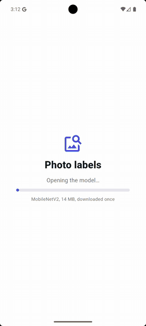
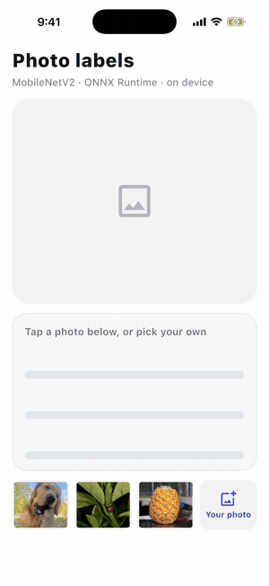
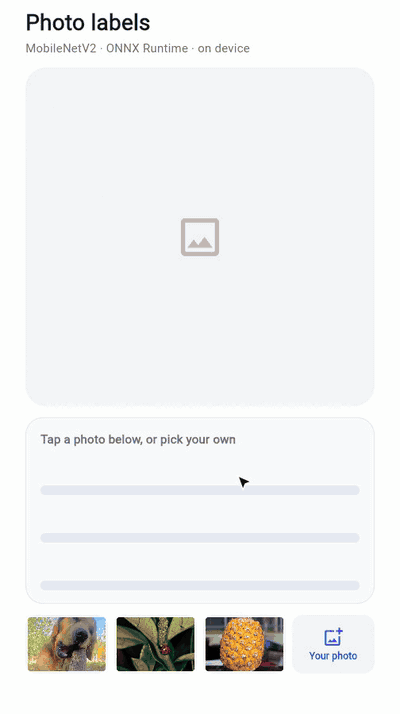

# Photo labels

An AI model looks at a photo and names what's in it: a dog, a ladybug, a pineapple, or any of 1,000 everyday things.
The app shows its three best guesses as bars that grow to each guess's probability. It all runs on the device, with
no server, so it works offline and the photos stay on the phone.

- The model is [MobileNetV2](https://github.com/onnx/models/tree/main/validated/vision/classification/mobilenet) from
  the ONNX Model Zoo, a 14 MB file. The app downloads it, its 1,000 ImageNet labels and the three sample photos on
  the first launch, showing the progress in a [`ProgressBar`](https://flet.dev/docs/controls/progressbar), then works
  offline. Without a network, it says so and offers **Try again**.
- [OpenCV](https://opencv.org) decodes the photo and crops it to the 224×224 square the model reads; one
  `model.run()` in [onnxruntime](https://onnxruntime.ai) scores all 1,000 labels, and the app keeps the top 3. The
  status line says how many milliseconds that took.
- **Tap a photo** under the results to label it. It scales in through an
  [`AnimatedSwitcher`](https://flet.dev/docs/controls/animatedswitcher) (its
  [`transition`](https://flet.dev/docs/controls/animatedswitcher#flet.AnimatedSwitcher.transition) is `SCALE`), then
  the three bars grow: the app raises each bar's
  [`value`](https://flet.dev/docs/controls/progressbar#flet.ProgressBar.value) and its percent in small steps, from
  Python. The best label stays under each photo you've tried.
- **Your photo** picks one of your own. The tile's
  [`action`](https://flet.dev/docs/controls/actioncontrol#flet.ActionControl.action) is a
  [`PickFiles`](https://flet.dev/docs/types/pickfiles), so the picker opens right in the tap, which browsers (iOS
  Safari above all) require. The photo comes to [`FilePicker`](https://flet.dev/docs/services/filepicker)'s
  [`on_result`](https://flet.dev/docs/services/filepicker#flet.FilePicker.on_result) with its
  [`bytes`](https://flet.dev/docs/types/filepickerfile#flet.FilePickerFile.bytes)
  ([`with_data`](https://flet.dev/docs/types/pickfiles#flet.PickFiles.with_data)), on every platform.
- The model runs in a thread (`asyncio.to_thread`), so the app stays responsive while it works.

|                                                         Android                                                          |                                                         iOS                                                         |
|:------------------------------------------------------------------------------------------------------------------------:|:-------------------------------------------------------------------------------------------------------------------:|
|  |  |

|                                                       Web                                                        |
|:----------------------------------------------------------------------------------------------------------------:|
|  |

The same code runs on macOS, Windows and Linux too, in a phone-shaped window. MobileNetV2 is Apache-2.0; the labels
are pytorch/hub's `imagenet_classes.txt` (BSD-3-Clause). Photos from Wikimedia Commons (CC0): *Golden Retriever
Chewing A Stick* by Cheetyuh, *Ladybug eating aphids* by David S. Ferry III, *Pineapple fruit 2* by Wilfredor; the
cat picked in the recordings is *Young tabby cat keeping watch* by W.carter.

## Run it

With [uv](https://docs.astral.sh/uv/):

```bash
uv run flet run           # desktop
uv run flet run --web     # browser
```

To try it on a phone, [debug](https://flet.dev/docs/cli/flet-debug) it on a connected device or emulator:

```bash
uv run flet debug android   # Android device or emulator
uv run flet debug ios       # iPhone or iOS simulator
```

To share it, [build](https://flet.dev/docs/publish) a package for any platform (desktop apps build on their own OS):

```bash
uv run flet build apk             # Android
uv run flet build ipa             # iOS
uv run flet build ios-simulator   # iOS simulator
uv run flet build macos           # macOS app
uv run flet build windows         # Windows app
uv run flet build linux           # Linux app
```

On Android and iOS, `flet build` takes onnxruntime, opencv-python and numpy from
[pypi.flet.dev](https://pypi.flet.dev), which has them built for phones (see
[binary packages](https://flet.dev/docs/reference/binary-packages-android-ios)). There's no static web build
(`flet build web`): it runs Python inside the browser, where onnxruntime and OpenCV aren't available. In a browser,
serve it with `uv run flet run --web` (or deploy it as a server app).

## Learn more

- [ProgressBar docs](https://flet.dev/docs/controls/progressbar)
- [AnimatedSwitcher](https://flet.dev/docs/controls/animatedswitcher)
- [FilePicker](https://flet.dev/docs/services/filepicker)
- [PickFiles](https://flet.dev/docs/types/pickfiles)
- [FilePickerResultEvent](https://flet.dev/docs/types/filepickerresultevent)
- [Client actions](https://flet.dev/docs/cookbook/client-actions)
- [Binary packages for Android and iOS](https://flet.dev/docs/reference/binary-packages-android-ios)
- [MobileNetV2 in the ONNX Model Zoo](https://github.com/onnx/models/tree/main/validated/vision/classification/mobilenet)
