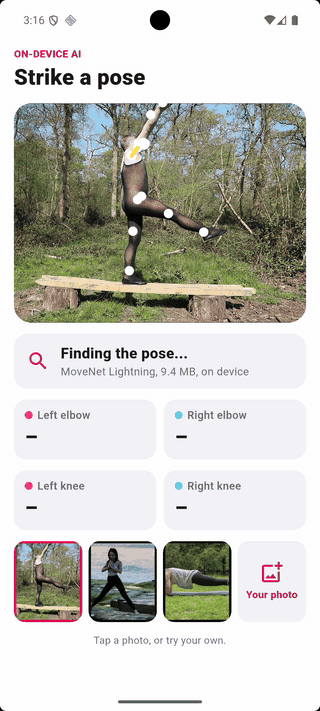
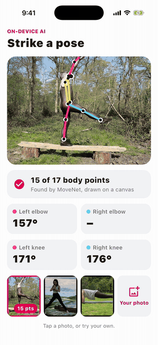
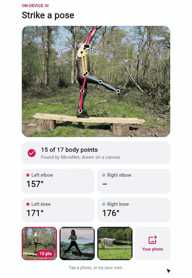

# Pose estimation

An AI model finds a person's shoulders, elbows, hips, knees and ankles in a photo, and the app draws their skeleton
on top and measures the angle at each elbow and knee. It all runs on the device, with no server.

- The model is Google's [MoveNet SinglePose Lightning](https://huggingface.co/Xenova/movenet-singlepose-lightning), a
  9.4 MB ONNX file. The app downloads it on the first launch, then works offline. One `model.run()` in
  [onnxruntime](https://onnxruntime.ai) gives 17 body points, each with its position and how sure the model is.
- The skeleton is drawn on a [`Canvas`](https://flet.dev/docs/controls/canvas): a
  [`Line`](https://flet.dev/docs/controls/canvas/line) for each bone and a
  [`Circle`](https://flet.dev/docs/controls/canvas/circle) for each point, added to its
  [`shapes`](https://flet.dev/docs/controls/canvas#flet.canvas.Canvas.shapes) one by one, so the skeleton draws
  itself. The canvas sits over an [`Image`](https://flet.dev/docs/controls/image) of the photo in a
  [`Stack`](https://flet.dev/docs/controls/stack).
- The same points give the angles: the angle at the elbow is the one between the shoulder, the elbow and the wrist.
- **Tap a photo** to read its pose, or **Your photo** to pick one of your own with
  [`FilePicker`](https://flet.dev/docs/services/filepicker)'s
  [`pick_files()`](https://flet.dev/docs/services/filepicker#flet.FilePicker.pick_files), which hands the app the
  file's [`bytes`](https://flet.dev/docs/types/filepickerfile#flet.FilePickerFile.bytes) on every platform.
  MoveNet works best when one person fills most of the photo.
- The model runs in a thread (`asyncio.to_thread`), so the app stays responsive while it works.

|                                                            Android                                                            |                                                           iOS                                                            |
|:-----------------------------------------------------------------------------------------------------------------------------:|:------------------------------------------------------------------------------------------------------------------------:|
|  |  |

|                                                         Web                                                          |
|:--------------------------------------------------------------------------------------------------------------------:|
|  |

The same code runs on macOS, Windows and Linux too. Photos from Wikimedia Commons (CC0): *Alfresco Ballet 9* by
AlfrescoBallet, *Yoga in the beach* by bady qb, *Yoga CDMX DSC0844* by Gobierno CDMX. MoveNet is Apache-2.0.

## Run it

With [uv](https://docs.astral.sh/uv/):

```bash
uv run flet run           # desktop
uv run flet run --web     # browser
```

To try it on a phone, [debug](https://flet.dev/docs/cli/flet-debug) it on a connected device or emulator:

```bash
uv run flet debug android   # Android device or emulator
uv run flet debug ios       # iPhone or iOS simulator
```

To share it, [build](https://flet.dev/docs/publish) a package for any platform (desktop apps build on their own OS):

```bash
uv run flet build apk       # Android
uv run flet build ipa       # iOS
uv run flet build macos     # macOS app
uv run flet build windows   # Windows app
uv run flet build linux     # Linux app
```

On Android and iOS, `flet build` takes onnxruntime, opencv-python and numpy from
[pypi.flet.dev](https://pypi.flet.dev), which has them built for phones (see
[binary packages](https://flet.dev/docs/reference/binary-packages-android-ios)). There's no static web build
(`flet build web`): it runs Python inside the browser, where onnxruntime and OpenCV aren't available. In a browser,
serve it with `uv run flet run --web` (or deploy it as a server app).

## Learn more

- [Canvas docs](https://flet.dev/docs/controls/canvas)
- [Line](https://flet.dev/docs/controls/canvas/line)
- [Circle](https://flet.dev/docs/controls/canvas/circle)
- [FilePicker](https://flet.dev/docs/services/filepicker)
- [FilePickerFile](https://flet.dev/docs/types/filepickerfile)
- [Binary packages for Android and iOS](https://flet.dev/docs/reference/binary-packages-android-ios)
- [MoveNet in ONNX](https://huggingface.co/Xenova/movenet-singlepose-lightning)
