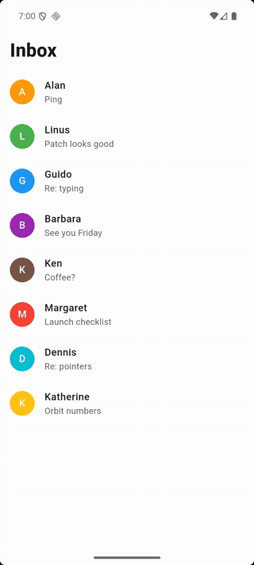
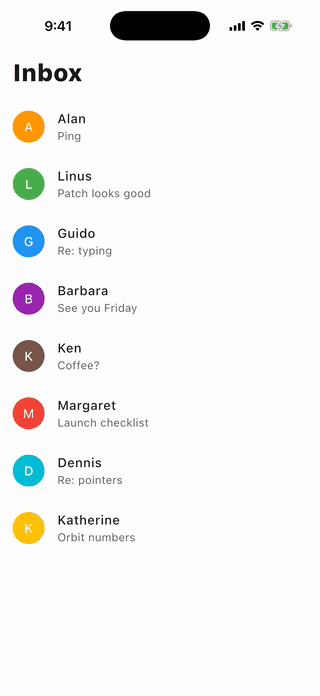
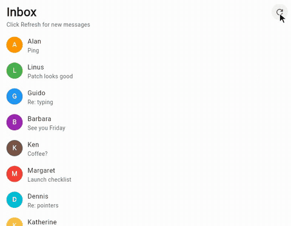

# Pull to refresh

An inbox that loads new messages when you pull it down. The list sits inside a
[`RefreshIndicator`](https://flet.dev/docs/controls/refreshindicator): pulling it down runs an async Python function
([`on_refresh`](https://flet.dev/docs/controls/refreshindicator#flet.RefreshIndicator.on_refresh)), and the spinner
keeps turning until that function returns:

- **On a phone,** pull the list down: a new message appears at the top, with an unread dot.
- **On desktop and the web,** where a mouse can't pull, click the **Refresh** button. It calls
  [`show()`](https://flet.dev/docs/controls/refreshindicator#flet.RefreshIndicator.show), which shows the same spinner
  and runs the same function. The app checks [`page.platform`](https://flet.dev/docs/controls/page#flet.Page.platform)
  and [`page.web`](https://flet.dev/docs/controls/page#flet.Page.web) to decide which hint and button to show.

|                                                               Android                                                               |                                                                iOS                                                                |
|:-----------------------------------------------------------------------------------------------------------------------------------:|:---------------------------------------------------------------------------------------------------------------------------------:|
|  |  |

|                                                                 Web                                                                 |
|:-----------------------------------------------------------------------------------------------------------------------------------:|
|  |

The same code runs on macOS, Windows and Linux too, with the Refresh button as on the web.

## Run it

With [uv](https://docs.astral.sh/uv/):

```bash
uv run flet run           # desktop
uv run flet run --web     # browser
```

To try it on a phone, [debug](https://flet.dev/docs/cli/flet-debug) it on a connected device or emulator:

```bash
uv run flet debug android   # Android device or emulator
uv run flet debug ios       # iPhone or iOS simulator
```

To share it, [build](https://flet.dev/docs/publish) a package for any platform (desktop apps build on their own OS):

```bash
uv run flet build apk       # Android
uv run flet build ipa       # iOS
uv run flet build macos     # macOS app
uv run flet build windows   # Windows app
uv run flet build linux     # Linux app
uv run flet build web       # static website
```

## Learn more

- [RefreshIndicator docs](https://flet.dev/docs/controls/refreshindicator)
