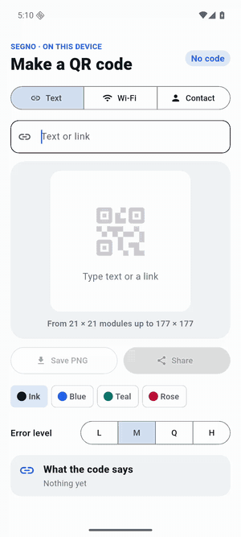
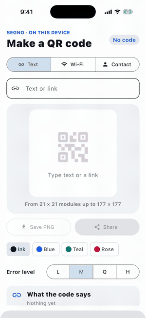
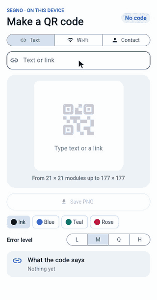

# Make a QR code

Type a link, and its QR code appears and redraws with every key. [segno](https://github.com/heuer/segno), a small
pure-Python package, makes the code right on the device: no server, no upload. It makes codes for a Wi-Fi network or a
contact card too, in any color, and saves them as PNG files. To read codes back from a photo, see
[Scan a barcode](../barcode-scanner).

- `segno.make_qr(text, error="m")` builds the code and picks the smallest version that fits: version 1 is 21 × 21
  squares ("modules"), and each version adds 4 more, up to 177 × 177 at version 40. Text longer than version 40
  holds (`segno.DataOverflowError`) shows "Too long for a QR code" instead. `qr.save(buffer, kind="png",
  dark=color)` writes it as PNG bytes into an `io.BytesIO`, and an [`Image`](https://flet.dev/docs/controls/image)
  shows those bytes as they are ([`src`](https://flet.dev/docs/controls/image#flet.Image.src) takes bytes), with
  [`gapless_playback`](https://flet.dev/docs/controls/image#flet.Image.gapless_playback) so it never blinks between
  keys.
- The [`TextField`](https://flet.dev/docs/controls/textfield)s'
  [`on_change`](https://flet.dev/docs/controls/textfield#flet.TextField.on_change) runs on every key, so the code,
  its version and size follow the text. The last card shows what the code says, exactly as a phone camera reads it.
- **Text**, **Wi-Fi** and **Contact** switch the form with a [`SegmentedButton`](https://flet.dev/docs/controls/segmentedbutton)
  ([`on_change`](https://flet.dev/docs/controls/segmentedbutton#flet.SegmentedButton.on_change)). A Wi-Fi code
  (`segno.helpers.make_wifi_data()`, `WIFI:T:WPA;S:...;P:...;;`) lets a phone camera join the network; the password
  field hides what you type ([`password`](https://flet.dev/docs/controls/textfield#flet.TextField.password)), and
  **Open** networks need none. A contact code is a vCard (`segno.helpers.make_vcard_data()`) with a name, phone and
  email, which phones offer to save. The phone and email fields bring up the matching keyboard on phones
  ([`keyboard_type`](https://flet.dev/docs/controls/textfield#flet.TextField.keyboard_type)).
- **Ink**, **Blue**, **Teal** and **Rose** are [`Chip`](https://flet.dev/docs/controls/chip)s that paint the code in
  their color ([`selected`](https://flet.dev/docs/controls/chip#flet.Chip.selected) marks the one in use).
- **Error level** (error correction) sets how much of the code can be damaged or covered and still read: L 7%,
  M 15%, Q 25% and H 30%. More correction needs more modules, so the code often grows a version or two. The app passes
  `boost_error=False`, so segno keeps the level you picked instead of raising it when a higher one fits.
- **Save PNG** writes the code, about 1000 px wide, with [`FilePicker`](https://flet.dev/docs/services/filepicker)'s
  [`save_file()`](https://flet.dev/docs/services/filepicker#flet.FilePicker.save_file). On desktop and phones you pick
  where it goes; in a browser it's downloaded.
- **Share** (on Android and iOS) opens the phone's share sheet with the PNG, through
  [`Share`](https://flet.dev/docs/services/share)'s
  [`share_files()`](https://flet.dev/docs/services/share#flet.Share.share_files) and
  [`ShareFile.from_bytes()`](https://flet.dev/docs/types/sharefile#flet.ShareFile.from_bytes). The app shows the
  button only where [`page.platform`](https://flet.dev/docs/controls/page#flet.Page.platform) is a phone and
  [`page.web`](https://flet.dev/docs/controls/page#flet.Page.web) is false.

|                                                                       Android                                                                       |                                                                        iOS                                                                        |                                                                       Web                                                                        |
|:---------------------------------------------------------------------------------------------------------------------------------------------------:|:-------------------------------------------------------------------------------------------------------------------------------------------------:|:------------------------------------------------------------------------------------------------------------------------------------------------:|
|  |  |  |

The same code runs on macOS, Windows and Linux too, as a phone-sized column centered in the window, where **Save PNG**
is the way to keep a code.

## Run it

With [uv](https://docs.astral.sh/uv/):

```bash
uv run flet run           # desktop
uv run flet run --web     # browser
```

To try it on a phone, [debug](https://flet.dev/docs/cli/flet-debug) it on a connected device or emulator:

```bash
uv run flet debug android   # Android device or emulator
uv run flet debug ios       # iPhone or iOS simulator
```

To share it, [build](https://flet.dev/docs/publish) a package for any platform (desktop apps build on their own OS):

```bash
uv run flet build apk             # Android
uv run flet build ipa             # iOS
uv run flet build ios-simulator   # iOS simulator
uv run flet build macos           # macOS app
uv run flet build windows         # Windows app
uv run flet build linux           # Linux app
uv run flet build web             # static website
```

segno is pure Python, so it goes into every build like any other
[dependency](https://flet.dev/docs/publish#app-dependencies), the static website included.

## Learn more

- [Image docs](https://flet.dev/docs/controls/image)
- [TextField](https://flet.dev/docs/controls/textfield)
- [SegmentedButton](https://flet.dev/docs/controls/segmentedbutton)
- [Chip](https://flet.dev/docs/controls/chip)
- [FilePicker](https://flet.dev/docs/services/filepicker)
- [Share](https://flet.dev/docs/services/share)
- [ShareFile](https://flet.dev/docs/types/sharefile)
- [segno](https://segno.readthedocs.io)
