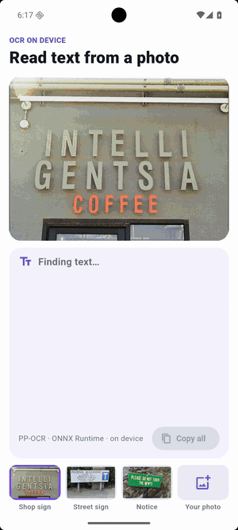
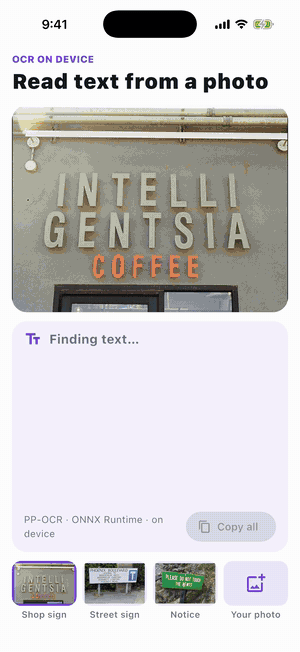
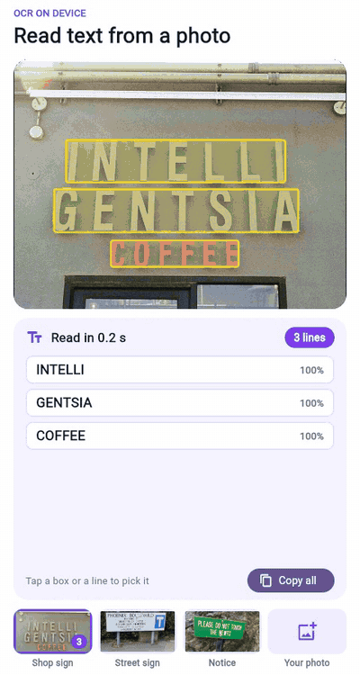

# Read text from a photo

Two small AI models find every line of text in a photo and read it, and the app draws a box around each line and
lists the words as real text you can copy. This is OCR (optical character recognition), and it all runs on the
device, with no server, so it works offline and the photos stay on the phone.

- The models are [PaddleOCR](https://github.com/PaddlePaddle/PaddleOCR)'s PP-OCR mobile models, in the ONNX files
  [RapidOCR](https://huggingface.co/SWHL/RapidOCR) publishes: PP-OCRv4 detection finds the text (4.7 MB) and PP-OCRv3
  English recognition reads it (9 MB). The app downloads them and the three sample photos on the first launch,
  showing the progress in a [`ProgressBar`](https://flet.dev/docs/controls/progressbar), then works offline.
  Without a network, it says so and offers **Try again**.
- No OCR package is needed: both models run in [onnxruntime](https://onnxruntime.ai), and a few dozen lines of NumPy
  and [OpenCV](https://opencv.org) do the rest. The finder marks the text pixels in a map, and each blob in the map
  becomes a box; each box is cut out and straightened, and the reader turns it into letters, with a score for how
  sure it is. Lines below 60% are left out.
- **Tap a photo** under the text to read it. Yellow boxes pop in over each line: each one is a
  [`Container`](https://flet.dev/docs/controls/container) placed with
  [`left`](https://flet.dev/docs/controls/layoutcontrol#flet.LayoutControl.left) and `top` in a
  [`Stack`](https://flet.dev/docs/controls/stack) over the photo, growing in with
  [`animate_scale`](https://flet.dev/docs/controls/layoutcontrol#flet.LayoutControl.animate_scale). Then the lines
  slide into the list, one by one. The photo's frame keeps a 4:3
  [`aspect_ratio`](https://flet.dev/docs/controls/layoutcontrol#flet.LayoutControl.aspect_ratio), and its
  [`on_size_change`](https://flet.dev/docs/controls/layoutcontrol#flet.LayoutControl.on_size_change) event gives the
  size it really has on screen, so the boxes stay on the text on any screen, and when a window is resized.
- **Tap a box or a line** to pick it: it turns purple in both places, the list
  [scrolls](https://flet.dev/docs/controls/scrollablecontrol#flet.ScrollableControl.scroll_to) to it, and the others
  fade. Tap it again to pick them all.
- **Copy all** (or **Copy line**) puts the text on the clipboard. The button's
  [`action`](https://flet.dev/docs/controls/actioncontrol#flet.ActionControl.action) is a
  [`CopyToClipboard`](https://flet.dev/docs/types/copytoclipboard), set to the text before the tap, so the copy
  happens right in the tap, which Safari requires.
- **Your photo** picks one of your own. That tile's `action` is a
  [`PickFiles`](https://flet.dev/docs/types/pickfiles), so the picker opens right in the tap too. The photo comes to
  [`FilePicker`](https://flet.dev/docs/services/filepicker)'s
  [`on_result`](https://flet.dev/docs/services/filepicker#flet.FilePicker.on_result) with its
  [`bytes`](https://flet.dev/docs/types/filepickerfile#flet.FilePickerFile.bytes)
  ([`with_data`](https://flet.dev/docs/types/pickfiles#flet.PickFiles.with_data)), on every platform. The reader
  knows English letters, digits and punctuation, and likes signs, labels and printed text best.
- The models run in a thread (`asyncio.to_thread`), so the app stays responsive while they work.

|                                                                           Android                                                                           |                                                                 iOS                                                                  |                                                                               Web                                                                               |
|:-----------------------------------------------------------------------------------------------------------------------------------------------------------:|:------------------------------------------------------------------------------------------------------------------------------------:|:---------------------------------------------------------------------------------------------------------------------------------------------------------------:|
|  |  |  |

The same code runs on macOS, Windows and Linux too, in a phone-shaped window. The PP-OCR models and RapidOCR's ONNX
files are Apache-2.0. Photos from Wikimedia Commons (CC0): *Coffee-sign-typography-shop* by www.Pixel.la Free Stock
Photos, *Phoenix Boulevard street name sign* by Malcolmxl5, *Please do not touch the newts* by Ruff tuff cream puff;
the photo picked in the recordings is *Please don't smash the windows sign* by Mx. Granger.

## Run it

With [uv](https://docs.astral.sh/uv/):

```bash
uv run flet run           # desktop
uv run flet run --web     # browser
```

To try it on a phone, [debug](https://flet.dev/docs/cli/flet-debug) it on a connected device or emulator:

```bash
uv run flet debug android   # Android device or emulator
uv run flet debug ios       # iPhone or iOS simulator
```

To share it, [build](https://flet.dev/docs/publish) a package for any platform (desktop apps build on their own OS):

```bash
uv run flet build apk             # Android
uv run flet build ipa             # iOS
uv run flet build ios-simulator   # iOS simulator
uv run flet build macos           # macOS app
uv run flet build windows         # Windows app
uv run flet build linux           # Linux app
```

On Android and iOS, `flet build` takes onnxruntime, opencv-python and numpy from
[pypi.flet.dev](https://pypi.flet.dev), which has them built for phones (see
[binary packages](https://flet.dev/docs/reference/binary-packages-android-ios)). There's no static web build
(`flet build web`): it runs Python inside the browser, where onnxruntime and OpenCV aren't available. In a browser,
serve it with `uv run flet run --web` (or deploy it as a server app).

## Learn more

- [Stack docs](https://flet.dev/docs/controls/stack)
- [Container](https://flet.dev/docs/controls/container)
- [CopyToClipboard](https://flet.dev/docs/types/copytoclipboard)
- [PickFiles](https://flet.dev/docs/types/pickfiles)
- [FilePicker](https://flet.dev/docs/services/filepicker)
- [FilePickerFile](https://flet.dev/docs/types/filepickerfile)
- [Binary packages for Android and iOS](https://flet.dev/docs/reference/binary-packages-android-ios)
- [PP-OCR in ONNX (RapidOCR)](https://huggingface.co/SWHL/RapidOCR)
