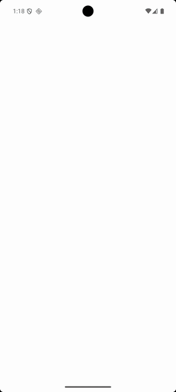
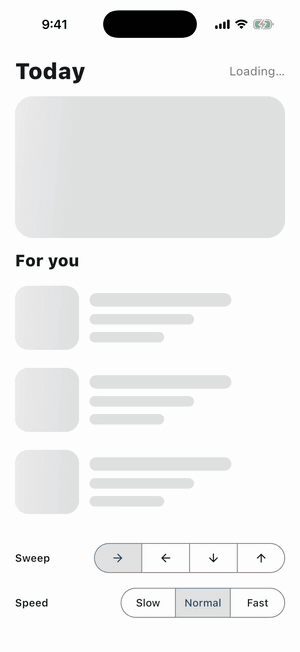
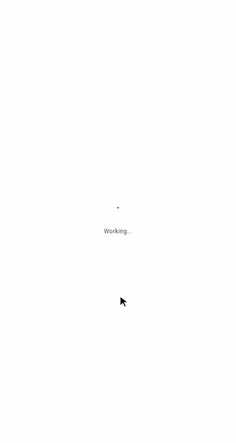

# Shimmer loading

A reading feed that shows grey placeholder shapes with a light sweeping across them while its articles load, then
fades in the real cards one after another. Placeholders like these tell people that content is on its way and
what shape it will take.

- Each placeholder is a few grey boxes wrapped in a [`Shimmer`](https://flet.dev/docs/controls/shimmer): its
  [`base_color`](https://flet.dev/docs/controls/shimmer#flet.Shimmer.base_color) and
  [`highlight_color`](https://flet.dev/docs/controls/shimmer#flet.Shimmer.highlight_color) make the sweep.
- Every place in the feed is an [`AnimatedSwitcher`](https://flet.dev/docs/controls/animatedswitcher). When an
  article "arrives" (the app pretends to download it), setting its
  [`content`](https://flet.dev/docs/controls/animatedswitcher#flet.AnimatedSwitcher.content) to the real card fades
  the card in over the placeholder.
- **Reload the feed:** on a phone, pull the list down. It sits in a
  [`RefreshIndicator`](https://flet.dev/docs/controls/refreshindicator) whose
  [`on_refresh`](https://flet.dev/docs/controls/refreshindicator#flet.RefreshIndicator.on_refresh) brings the
  placeholders back and loads the cards again, while the spinner turns. On desktop and the web, where a mouse can't
  pull, click the **Refresh** button: it calls
  [`show()`](https://flet.dev/docs/controls/refreshindicator#flet.RefreshIndicator.show), which runs the same handler.
  The app checks [`page.platform`](https://flet.dev/docs/controls/page#flet.Page.platform) and
  [`page.web`](https://flet.dev/docs/controls/page#flet.Page.web) to decide.
- **Change the sweep** with the two [`SegmentedButton`](https://flet.dev/docs/controls/segmentedbutton)s at the
  bottom: the light can travel right, left, down or up
  ([`direction`](https://flet.dev/docs/controls/shimmer#flet.Shimmer.direction)), slowly or fast
  ([`period`](https://flet.dev/docs/controls/shimmer#flet.Shimmer.period), the length of one sweep). The feed reloads
  so you can see it; while it's loading, the placeholders on screen change at once.
- **Save an article** with its bookmark, an [`IconButton`](https://flet.dev/docs/controls/iconbutton) that switches
  to its [`selected_icon`](https://flet.dev/docs/controls/iconbutton#flet.IconButton.selected_icon). Saved articles
  stay saved when the feed reloads.

|                                                                Android                                                                 |                                                               iOS                                                                |
|:--------------------------------------------------------------------------------------------------------------------------------------:|:--------------------------------------------------------------------------------------------------------------------------------:|
|  |  |

|                                                                   Web                                                                   |
|:---------------------------------------------------------------------------------------------------------------------------------------:|
|  |

The same code runs on macOS, Windows and Linux too, with the Refresh button as on the web. Photos from Wikimedia
Commons, CC0 (originally on Unsplash): *NaPali Coast* by Josh Austin, *Road along the fjord* by Danny Froese,
*Polar lights over dark trees* by Vincent Guth, *Desert Dunes* by Joe Mania, *Misty coniferous forest on a slope* by
Jon Flobrant, *Mossy rock mountain and waterfall* by Jacek Smoter, *Clouds mirrored in a mountain lake* by Ales
Krivec. They ship with the app in `assets/`, so it works offline.

## Run it

With [uv](https://docs.astral.sh/uv/):

```bash
uv run flet run           # desktop
uv run flet run --web     # browser
```

To try it on a phone, [debug](https://flet.dev/docs/cli/flet-debug) it on a connected device or emulator:

```bash
uv run flet debug android   # Android device or emulator
uv run flet debug ios       # iPhone or iOS simulator
```

To share it, [build](https://flet.dev/docs/publish) a package for any platform (desktop apps build on their own OS):

```bash
uv run flet build apk             # Android
uv run flet build ipa             # iOS
uv run flet build ios-simulator   # iOS simulator
uv run flet build macos           # macOS app
uv run flet build windows         # Windows app
uv run flet build linux           # Linux app
uv run flet build web             # static website
```

## Learn more

- [Shimmer docs](https://flet.dev/docs/controls/shimmer)
- [AnimatedSwitcher](https://flet.dev/docs/controls/animatedswitcher)
- [RefreshIndicator](https://flet.dev/docs/controls/refreshindicator)
- [SegmentedButton](https://flet.dev/docs/controls/segmentedbutton)
- [IconButton](https://flet.dev/docs/controls/iconbutton)
