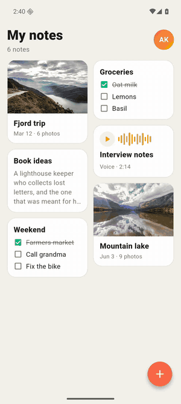
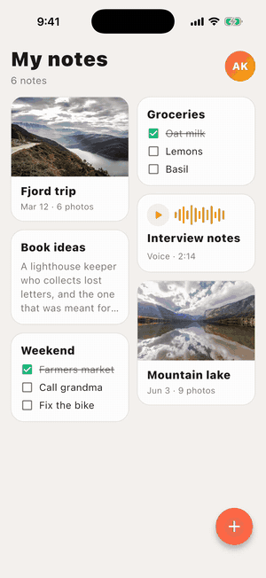
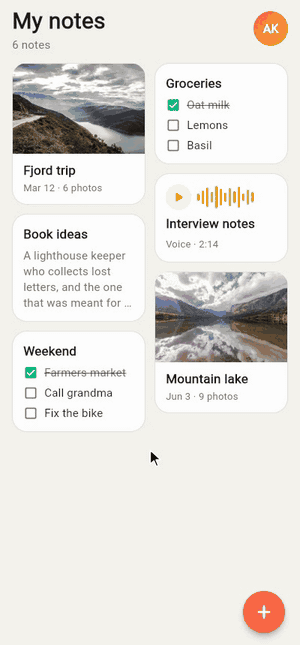

# Speed dial

A small notes app with a speed dial: tap the round + button and four labeled actions (Text note, Checklist, Voice
memo, Photo) pop out above it, one after another, while the notes behind dim. Pick one and a new note of that kind
grows in at the top of your notes.

- **Tap +**: each action is a [`Container`](https://flet.dev/docs/controls/container) whose
  [`scale`](https://flet.dev/docs/controls/layoutcontrol#flet.LayoutControl.scale),
  [`offset`](https://flet.dev/docs/controls/layoutcontrol#flet.LayoutControl.offset) and
  [`opacity`](https://flet.dev/docs/controls/control#flet.Control.opacity) change with
  [`animate_scale`](https://flet.dev/docs/controls/layoutcontrol#flet.LayoutControl.animate_scale),
  [`animate_offset`](https://flet.dev/docs/controls/layoutcontrol#flet.LayoutControl.animate_offset) and
  [`animate_opacity`](https://flet.dev/docs/controls/layoutcontrol#flet.LayoutControl.animate_opacity) set, so they
  grow, rise and fade in. The app shows them one by one, nearest first, with a short `asyncio.sleep` in between:
  that's the stagger.
- **The + turns into an x**: the icon inside the
  [`FloatingActionButton`](https://flet.dev/docs/controls/floatingactionbutton) spins 135 degrees
  ([`rotate`](https://flet.dev/docs/controls/layoutcontrol#flet.LayoutControl.rotate) with
  [`animate_rotation`](https://flet.dev/docs/controls/layoutcontrol#flet.LayoutControl.animate_rotation)).
- **The scrim**: a dark `Container` between the notes and the dial, in a [`Stack`](https://flet.dev/docs/controls/stack),
  fades in. While the dial is closed,
  [`ignore_interactions`](https://flet.dev/docs/controls/container#flet.Container.ignore_interactions) lets taps
  reach the notes below it.
- **Close it** by tapping the dimmed screen, the x, or an action; the actions fold back in reverse order. On desktop
  and web, **Escape** closes it too ([`on_keyboard_event`](https://flet.dev/docs/controls/page#flet.Page.on_keyboard_event)).
- **Pick an action**: a new note of that kind (a text note, a checklist, a voice memo or a photo) grows in at the top
  of the shorter column, as an empty `Container` with
  [`animate_size`](https://flet.dev/docs/controls/layoutcontrol#flet.LayoutControl.animate_size) gets its note, and
  the count goes up. A [`SnackBar`](https://flet.dev/docs/controls/snackbar) beside the + offers
  [Undo](https://flet.dev/docs/controls/snackbar#flet.SnackBar.on_action), which shrinks the note away.
- The whole dial is one function, `speed_dial(actions, on_pick)`: copy it (with `DialAction` and the constants above
  it) into your own app, put the layer it returns on top of your screen in a `Stack`, and handle `on_pick`.

| Android | iOS | Web |
| :---: | :---: | :---: |
|  |  |  |

The same code runs on macOS, Windows and Linux too, where the dial sits in the window's bottom-right corner and
Escape closes it. Photos from Wikimedia Commons, [CC0](https://creativecommons.org/publicdomain/zero/1.0/)
(originally on Unsplash):
[*Road along the fjord*](https://commons.wikimedia.org/wiki/File:Road_along_the_fjord_(Unsplash).jpg) by Danny
Froese,
[*Clouds mirrored in a mountain lake*](https://commons.wikimedia.org/wiki/File:Clouds_mirrored_in_a_mountain_lake_(Unsplash).jpg)
by Ales Krivec,
[*Polar lights over dark trees*](https://commons.wikimedia.org/wiki/File:Polar_lights_over_dark_trees_(Unsplash).jpg)
by Vincent Guth,
[*Misty coniferous forest on a slope*](https://commons.wikimedia.org/wiki/File:Misty_coniferous_forest_on_a_slope_(Unsplash).jpg)
by Jon Flobrant. They ship with the app in `assets/`, so it works offline.

## Run it

With [uv](https://docs.astral.sh/uv/):

```bash
uv run flet run           # desktop
uv run flet run --web     # browser
```

To try it on a phone, [debug](https://flet.dev/docs/cli/flet-debug) it on a connected device or emulator:

```bash
uv run flet debug android   # Android device or emulator
uv run flet debug ios       # iPhone or iOS simulator
```

To share it, [build](https://flet.dev/docs/publish) a package for any platform (desktop apps build on their own OS):

```bash
uv run flet build apk             # Android
uv run flet build ipa             # iOS
uv run flet build ios-simulator   # iOS simulator
uv run flet build macos           # macOS app
uv run flet build windows         # Windows app
uv run flet build linux           # Linux app
uv run flet build web             # static website
```

## Learn more

- [FloatingActionButton docs](https://flet.dev/docs/controls/floatingactionbutton)
- [Animations cookbook](https://flet.dev/docs/cookbook/animations)
- [Container](https://flet.dev/docs/controls/container)
- [Stack](https://flet.dev/docs/controls/stack)
- [SnackBar](https://flet.dev/docs/controls/snackbar)
- [Animation](https://flet.dev/docs/types/animation)
- [KeyboardEvent](https://flet.dev/docs/types/keyboardevent)
