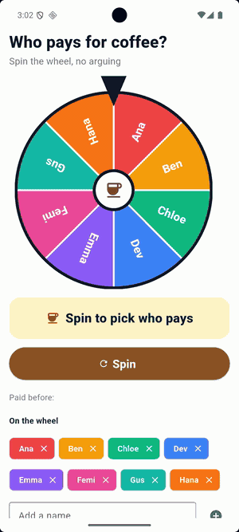
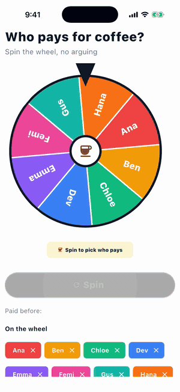
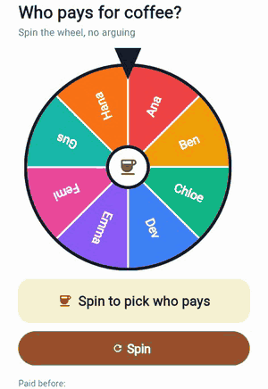

# Spin the wheel

Who pays for coffee? Put the names on a wheel, spin it, and let it decide. The wheel slows down like a real one, and
you hear a click each time a slice passes the pointer. The sounds aren't audio files: Python makes them with NumPy.

- **Spin** adds five turns (and a bit) to a [`Container`](https://flet.dev/docs/controls/container)'s
  [`rotate`](https://flet.dev/docs/controls/layoutcontrol#flet.LayoutControl.rotate). Its
  [`animate_rotation`](https://flet.dev/docs/controls/layoutcontrol#flet.LayoutControl.animate_rotation) is a 5-second
  [`DECELERATE`](https://flet.dev/docs/types/animationcurve#flet.AnimationCurve.DECELERATE) [`Animation`](https://flet.dev/docs/types/animation),
  so the wheel slows down evenly and stops on the winner.
- The wheel is a [`Canvas`](https://flet.dev/docs/controls/canvas): an [`Arc`](https://flet.dev/docs/controls/canvas/arc) for each slice and a
  rotated [`Text`](https://flet.dev/docs/controls/canvas/text) for each name.
- The click is 30 ms of a fading sine wave, made with NumPy and written to WAV bytes with Python's `wave` module.
  [`flet_audio.Audio`](https://flet.dev/docs/services/audio) plays it straight from those bytes
  ([`src`](https://flet.dev/docs/services/audio#flet_audio.Audio.src)), and
  [`release_mode=STOP`](https://flet.dev/docs/services/audio#flet_audio.Audio.release_mode) keeps it loaded, so each replay starts
  at once. A two-tone chime plays when the wheel stops.
- `DECELERATE` follows `1 - (1 - t)²`, so the app solves it for every slice edge to know when that edge passes the
  pointer: that's when each tick plays, and the ticks slow down with the wheel.
- **Add or remove names** with the field and the chips' ✕ ([`on_delete`](https://flet.dev/docs/controls/chip#flet.Chip.on_delete)):
  the wheel redraws with one slice per name, from 2 to 12.

|                                                  Android                                                  |                                                 iOS                                                 |
|:---------------------------------------------------------------------------------------------------------:|:---------------------------------------------------------------------------------------------------:|
|  |  |

|                                     Web                                     |
|:---------------------------------------------------------------------------:|
|  |

The same code runs on macOS, Windows and Linux too. On iOS and macOS, flet-audio can't play bytes yet, so the app
writes each sound to a `.wav` file there first.

## Run it

With [uv](https://docs.astral.sh/uv/):

```bash
uv run flet run           # desktop
uv run flet run --web     # browser
```

To try it on a phone, [debug](https://flet.dev/docs/cli/flet-debug) it on a connected device or emulator:

```bash
uv run flet debug android   # Android device or emulator
uv run flet debug ios       # iPhone or iOS simulator
```

To share it, [build](https://flet.dev/docs/publish) a package for any platform (desktop apps build on their own OS):

```bash
uv run flet build apk       # Android
uv run flet build ipa       # iOS
uv run flet build macos     # macOS app
uv run flet build windows   # Windows app
uv run flet build linux     # Linux app
uv run flet build web       # static website
```
## Learn more

- [Animations cookbook](https://flet.dev/docs/cookbook/animations)
- [Audio docs](https://flet.dev/docs/services/audio)
- [Canvas](https://flet.dev/docs/controls/canvas)
- [Animation](https://flet.dev/docs/types/animation)
- [AnimationCurve](https://flet.dev/docs/types/animationcurve)
- [Chip](https://flet.dev/docs/controls/chip)
