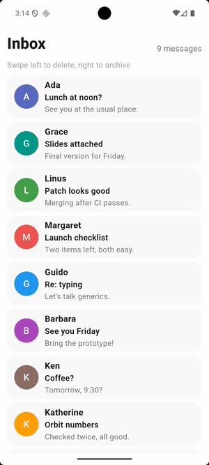
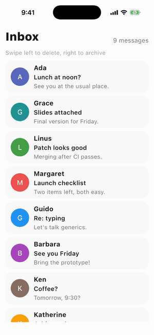
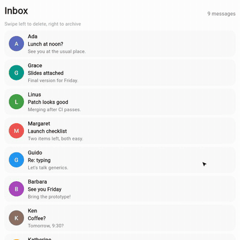

# Swipe to dismiss

An inbox where you swipe emails away: right to archive, left to delete, with an **Undo** that brings them back.

- Each email is a [`Dismissible`](https://flet.dev/docs/controls/dismissible). Its
  [`background`](https://flet.dev/docs/controls/dismissible#flet.Dismissible.background) (green, Archive) shows while it's swiped
  right, its [`secondary_background`](https://flet.dev/docs/controls/dismissible#flet.Dismissible.secondary_background) (red,
  Delete) while it's swiped left.
- Once an email is swiped away, [`on_dismiss`](https://flet.dev/docs/controls/dismissible#flet.Dismissible.on_dismiss) removes it
  from the list; the event's [`direction`](https://flet.dev/docs/types/dismissibledismissevent#flet.DismissibleDismissEvent.direction)
  tells archive from delete.
- A [`SnackBar`](https://flet.dev/docs/controls/snackbar) says what happened, and its
  [`action`](https://flet.dev/docs/controls/snackbar#flet.SnackBar.action) puts the email back where it was.
- When the inbox is empty, **Bring them back** refills it.

|                                                  Android                                                  |                                                 iOS                                                 |
|:---------------------------------------------------------------------------------------------------------:|:---------------------------------------------------------------------------------------------------:|
|  |  |

|                                     Web                                     |
|:---------------------------------------------------------------------------:|
|  |

The same code runs on macOS, Windows and Linux too, where you drag an email sideways with the mouse.

## Run it

With [uv](https://docs.astral.sh/uv/):

```bash
uv run flet run           # desktop
uv run flet run --web     # browser
```

To try it on a phone, [debug](https://flet.dev/docs/cli/flet-debug) it on a connected device or emulator:

```bash
uv run flet debug android   # Android device or emulator
uv run flet debug ios       # iPhone or iOS simulator
```

To share it, [build](https://flet.dev/docs/publish) a package for any platform (desktop apps build on their own OS):

```bash
uv run flet build apk       # Android
uv run flet build ipa       # iOS
uv run flet build macos     # macOS app
uv run flet build windows   # Windows app
uv run flet build linux     # Linux app
uv run flet build web       # static website
```
## Learn more

- [Dismissible docs](https://flet.dev/docs/controls/dismissible)
- [DismissibleDismissEvent](https://flet.dev/docs/types/dismissibledismissevent)
- [SnackBar](https://flet.dev/docs/controls/snackbar)
- [SnackBarAction](https://flet.dev/docs/controls/snackbar#flet.SnackBarAction-properties)
