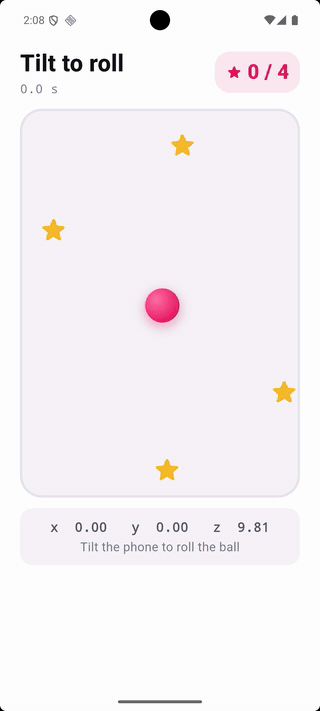
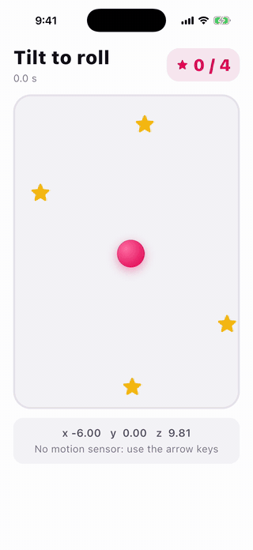
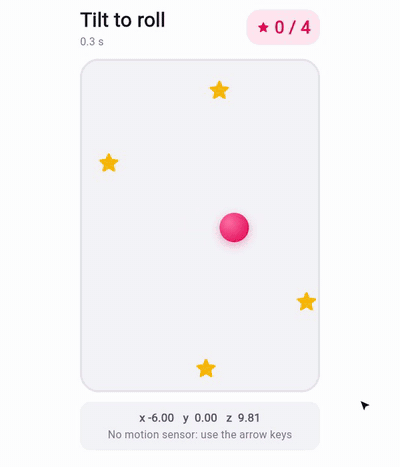

# Tilt game

Tilt the phone and a ball rolls to the lower side of the box. Roll it over all four stars as fast as you can.

- The phone's tilt comes from [`Accelerometer`](https://flet.dev/docs/services/accelerometer): it sends a reading
  every 40 ms ([`interval`](https://flet.dev/docs/services/accelerometer#flet.Accelerometer.interval)), and
  [`on_reading`](https://flet.dev/docs/services/accelerometer#flet.Accelerometer.on_reading) gets
  [`x`](https://flet.dev/docs/types/accelerometerreadingevent#flet.AccelerometerReadingEvent.x),
  [`y`](https://flet.dev/docs/types/accelerometerreadingevent#flet.AccelerometerReadingEvent.y) and
  [`z`](https://flet.dev/docs/types/accelerometerreadingevent#flet.AccelerometerReadingEvent.z) in m/s², gravity
  included. Lying flat, the phone reads about `x 0, y 0, z 9.81`; tilted right, `x` goes negative.
- A small loop, about 30 times a second, turns the tilt into speed, moves the ball, bounces it off the walls and
  pops the stars it touches. The card under the box shows the tilt in use.
- **No motion sensor?** Hold the arrow keys: a
  [`KeyboardListener`](https://flet.dev/docs/controls/keyboardlistener) tilts the box for you. That's how it plays
  on desktop, in a browser on a computer, and in the iOS simulator, which has no accelerometer.
- When the last star pops, the clock stops, your best time is kept, and **Play again** scatters new stars.

|                                                                Android                                                                |                                                       iOS                                                       |
|:-------------------------------------------------------------------------------------------------------------------------------------:|:---------------------------------------------------------------------------------------------------------------:|
|  |  |

|                                                          Web                                                          |
|:---------------------------------------------------------------------------------------------------------------------:|
|  |

The same code runs on macOS, Windows and Linux too, with the arrow keys. In a browser on a phone, it uses the
phone's tilt where the browser shares it.

## Run it

With [uv](https://docs.astral.sh/uv/):

```bash
uv run flet run           # desktop
uv run flet run --web     # browser
```

To try it on a phone, [debug](https://flet.dev/docs/cli/flet-debug) it on a connected device or emulator:

```bash
uv run flet debug android   # Android device or emulator
uv run flet debug ios       # iPhone or iOS simulator
```

To share it, [build](https://flet.dev/docs/publish) a package for any platform (desktop apps build on their own OS):

```bash
uv run flet build apk       # Android
uv run flet build ipa       # iOS
uv run flet build macos     # macOS app
uv run flet build windows   # Windows app
uv run flet build linux     # Linux app
uv run flet build web       # static website
```

## Learn more

- [Accelerometer docs](https://flet.dev/docs/services/accelerometer)
- [AccelerometerReadingEvent](https://flet.dev/docs/types/accelerometerreadingevent)
- [SensorErrorEvent](https://flet.dev/docs/types/sensorerrorevent)
- [KeyboardListener](https://flet.dev/docs/controls/keyboardlistener)
