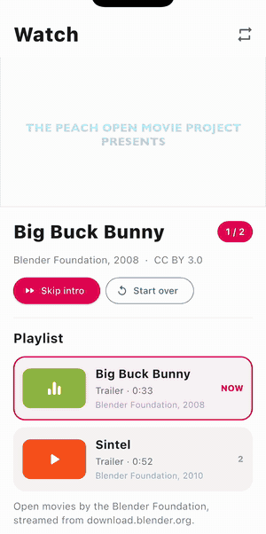
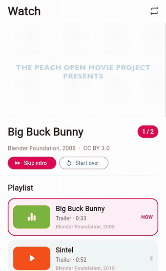

# Video playlist

A small video player built with [flet-video](https://flet.dev/docs/controls/video): two trailers in a playlist, a
button that skips each video's intro, and a list under the player that always shows which video is playing.

- The player is one [`Video`](https://flet.dev/docs/controls/video) control. Its
  [`playlist`](https://flet.dev/docs/controls/video#flet_video.Video.playlist) holds a
  [`VideoMedia`](https://flet.dev/docs/controls/video/types/videomedia) for each video link, and
  [`autoplay`](https://flet.dev/docs/controls/video#flet_video.Video.autoplay) starts the first one at once. Its
  [`aspect_ratio`](https://flet.dev/docs/controls/layoutcontrol#flet.LayoutControl.aspect_ratio) keeps it 16:9 at any
  width. The play, pause, skip and seek bar buttons on the video are the player's own
  [`controls`](https://flet.dev/docs/controls/video#flet_video.Video.controls): touch controls on phones, mouse
  controls on desktop and web.
- **Skip intro** calls [`seek()`](https://flet.dev/docs/controls/video#flet_video.Video.seek) with the second where
  the playing video's intro ends (0:07 in Big Buck Bunny, 0:11 in Sintel). **Start over** seeks back to 0:00.
- **Tap a video in the list** to play it:
  [`jump_to()`](https://flet.dev/docs/controls/video#flet_video.Video.jump_to) switches to that video in the playlist.
- [`on_track_change`](https://flet.dev/docs/controls/video#flet_video.Video.on_track_change) fires each time the
  player moves to another video, with its index: after a tap in the list, a tap on the player's own skip buttons, or
  at the end of a video. The app then frames that video's row, marks it **NOW** and updates the title above the list.
- **The loop button** in the top corner switches
  [`playlist_mode`](https://flet.dev/docs/controls/video#flet_video.Video.playlist_mode) between
  [`NONE`](https://flet.dev/docs/controls/video/types/playlistmode#flet_video.PlaylistMode.NONE) (stop after the last
  video) and [`LOOP`](https://flet.dev/docs/controls/video/types/playlistmode#flet_video.PlaylistMode.LOOP) (start the
  list again).

The videos are the trailers of [Big Buck Bunny](https://peach.blender.org/) (2008) and
[Sintel](https://durian.blender.org/) (2010), open movies by the Blender Foundation, licensed
[CC BY 3.0](https://creativecommons.org/licenses/by/3.0/) and streamed from download.blender.org. The app needs an
internet connection.

|                                                                iOS                                                                |                                                               Web                                                                |
|:---------------------------------------------------------------------------------------------------------------------------------:|:--------------------------------------------------------------------------------------------------------------------------------:|
|  |  |

The same code runs on Android, macOS, Windows and Linux too. There's no Android recording: the Android emulator plays
the videos but draws a black picture.

In a browser, the videos play from a static `flet build web` on a plain web server, as in the recording.
`flet run --web` serves the app with the `Cross-Origin-Embedder-Policy: require-corp` header, so the browser only
loads videos from sites that allow it, and download.blender.org doesn't: there, the player stays black.

## Run it

With [uv](https://docs.astral.sh/uv/):

```bash
uv run flet run           # desktop
uv run flet run --web     # browser (the videos stay black, see above)
```

On Linux, the video player is only in the **full** desktop client. This app's `pyproject.toml` asks for it with
`desktop_flavor = "full"` (or set
[`FLET_DESKTOP_FLAVOR=full`](https://flet.dev/docs/reference/environment-variables#flet_desktop_flavor)), and the full
client needs the system's `libmpv` and GStreamer libraries, as the
[Video setup guide](https://flet.dev/docs/controls/video#linux) explains. On macOS and Windows, nothing extra is
needed.

To try it on a phone, [debug](https://flet.dev/docs/cli/flet-debug) it on a connected device or emulator:

```bash
uv run flet debug android   # Android device or emulator
uv run flet debug ios       # iPhone or iOS simulator
```

To share it, [build](https://flet.dev/docs/publish) a package for any platform (desktop apps build on their own OS):

```bash
uv run flet build apk             # Android
uv run flet build ipa             # iOS
uv run flet build ios-simulator   # iOS simulator
uv run flet build macos           # macOS app
uv run flet build windows         # Windows app
uv run flet build linux           # Linux app
uv run flet build web             # static website
```

## Learn more

- [Video docs](https://flet.dev/docs/controls/video)
- [VideoMedia](https://flet.dev/docs/controls/video/types/videomedia)
- [PlaylistMode](https://flet.dev/docs/controls/video/types/playlistmode)
- [AdaptiveVideoControls](https://flet.dev/docs/controls/video/types/adaptivevideocontrols)
- [Duration](https://flet.dev/docs/types/duration)
